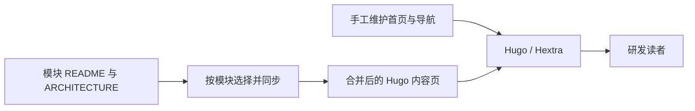

# LoadUp 文档站架构

文档正文以各生产者仓库的 README 和 ARCHITECTURE 为维护入口。站点保留 Hugo/Hextra 模板、首页、导航和 Markdown 生成页。Framework 的同步器沿 Maven reactor 发现模块，按工件生成页面，并将接入手册及设计合并成一个阅读入口。Mermaid 代码块交给站点配置的前端渲染器。

站点同时收录多个仓库。Framework 同步器负责 Framework reactor 页面，使用明确模块选择可限定更新范围。Modules 与 Testify 页面维持各自的来源映射。Pay 站点目前提供支付渠道介绍，完整 Pay 设计从 [Pay 仓库](../loadup-pay/ARCHITECTURE.md) 查看。

[维护操作](README.md)
