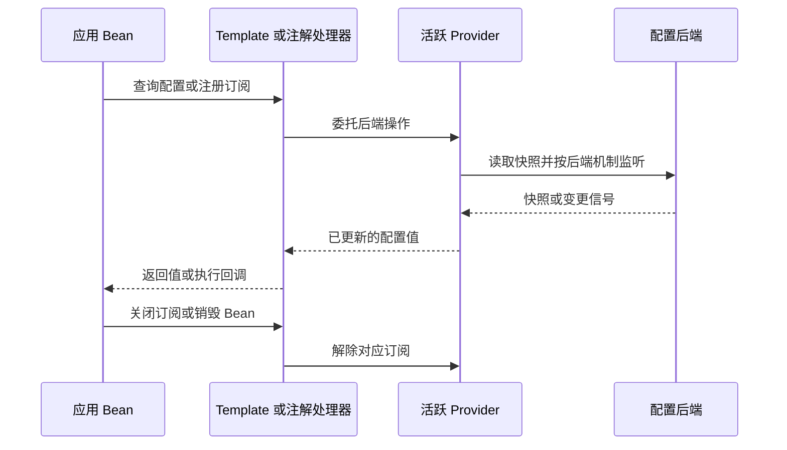

<!-- Generated by doc-sync-agent.py; sources: loadup-components/platform/loadup-components-configcenter/README.md, loadup-components/platform/loadup-components-configcenter/ARCHITECTURE.md -->

业务代码使用 `ConfigCenterTemplate` 查询、发布和订阅配置，或用 `@DynamicConfig` 将 Spring bean 字段和回调绑定到配置键。应用通过 binder 依赖和 `loadup.configcenter.binder-type` 选择 XXL-Conf、Nacos 或 Apollo。

## 快速开始

添加对应 binder。业务库可单独依赖 `loadup-components-configcenter-api`。

```xml
<dependency>
    <groupId>io.github.loadup-cloud</groupId>
    <artifactId>loadup-components-configcenter-binder-xxl-conf</artifactId>
</dependency>
```

```yaml
loadup:
  configcenter:
    binder-type: xxl-conf
    binder:
      xxl-conf:
        address: http://localhost:8080/xxl-conf
        access-token: ${XXL_CONF_ACCESS_TOKEN}
        app-name: payments
        env: test
```

```java
import io.github.loadup.components.configcenter.DynamicConfig;
import org.springframework.stereotype.Component;

@Component
public class FeatureFlags {
    @DynamicConfig(value = "feature.payment.enabled", defaultValue = "false")
    private volatile boolean paymentEnabled;

    @DynamicConfig("feature.payment.mode")
    void paymentModeChanged(String mode) {
        // Apply the initial mode and subsequent changes. A missing value is null.
    }

    public boolean isPaymentEnabled() {
        return paymentEnabled;
    }
}
```

注解在单例 Spring bean 初始化后注册，应用启动时读取初值，后续变更异步生效。字段须为非静态、非 final 的 `volatile` 字段，使用 Spring 类型转换。回调签名为 `void method(String value)`。键和默认值支持 Spring 属性占位符。缺失或删除时使用默认值，省略默认值时传入 `null`。基本类型字段需要可转换的初值或默认值。Spring 销毁 bean 时解除注解订阅。

## Template 能力矩阵

| 能力 | XXL-Conf 2.2.1 | Nacos | Apollo |
|---|---|---|---|
| `getConfig(key[, default])`、`listKeys(prefix)` | OpenAPI，按环境和应用查询 | SDK 配置文档快照 | SDK 已发布配置 |
| `setConfig(key, value)`、`removeConfig(key)` | 返回 `false`，写入和删除通过 XXL-Conf 管理台 | SDK 按文档 CAS 发布 | 配置 Portal 凭证后编辑并发布 namespace |
| `addListener(key, consumer)`、`@DynamicConfig` | OpenAPI 长轮询与查值 | SDK 文档监听 | SDK namespace 监听 |

`setConfig` 或 `removeConfig` 返回 `true` 表示后端已接受操作。Nacos 和 Apollo 在 SDK 收到更新后刷新读取和监听。程序化监听只接收变更，配置删除时收到 `null`。`removeListener(key)` 仅移除当前 Template 登记的程序化监听。

## 迁移原 Local binder

将依赖换为 `loadup-components-configcenter-binder-xxl-conf`，设置 `binder-type: xxl-conf`，按应用和环境在 XXL-Conf 管理台录入配置键及初始值。原 Local binder 的进程内写入需要改由管理台完成，或使用支持程序化发布的 Nacos 或 Apollo。可用模块包括 [XXL-Conf](../configcenter-binder-xxl-conf/)、[Nacos](../configcenter-binder-nacos/) 和 [Apollo](../configcenter-binder-apollo/)。

---

<a id="architecture"></a>
## 设计与实现

ConfigCenter 采用单后端模式。API 定义 `ConfigCenterTemplate`、`ConfigCenterProvider` 和 `@DynamicConfig`。各 binder 按 `loadup.configcenter.binder-type` 装配 Provider，并持有底层 SDK 或 OpenAPI 客户端的生命周期。API 自动配置在存在唯一 Provider 时装配默认 Template 和注解处理器。

Template 委托 Provider 处理查询和发布。注解处理器和 Template 通过同一个 Provider 注册独立订阅，Provider 返回单个订阅的解除操作。Template 保存程序化订阅，Spring bean 的销毁回调清理注解订阅。

### 查询与变更分派



XXL-Conf 用官方 OpenAPI 做查键、查值和长轮询。收到变更信号后批量重查当前订阅键，等待超时和重连期间也会重新对比。Nacos 将一个 `dataId + group` 文档转换为键值快照，用 SDK 订阅刷新。Apollo 用 SDK 订阅已发布配置，可选的 Portal OpenAPI 负责编辑和发布。
