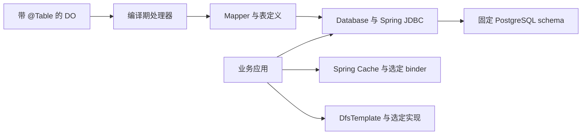

<!-- Generated by doc-sync-agent.py; sources: loadup-components/data/README.md, loadup-components/data/ARCHITECTURE.md -->

消费应用导入 [Framework BOM](../../dependencies/)，再按需求选择下表中的工件。此目录的聚合 POM 用于组织 Maven 子模块。

| 组件 | 适用场景 | 接入要点 |
| --- | --- | --- |
| [KV 与缓存](../kv/) | Spring Cache 的本地、分布式或多级缓存 | 按所需的过期、并发和跨实例语义选择 Caffeine、Redis 或 JetCache。 |
| [数据库](../database/) | PostgreSQL 持久化、事务、业务 ID | 在宿主指定固定 schema，并将连接与迁移指向该 schema。 |
| [数据库处理器](../database-processor/) | 生成 MyBatis-Flex Mapper 和表定义 | 配置在 Java 编译器的注解处理器路径。 |
| [文件存储](../dfs/) | 文件内容、元数据与可选分片 | 按需选择 Local、S3 或 Database binder。 |

[分类架构](./#architecture) · [全部组件](../)

---

## 设计与实现

### 职责与依赖

数据库与 DFS 各自拥有持久化边界。应用在数据库中维护业务记录，在 DFS 中维护文件内容和存储元数据，并对跨存储写入安排补偿。Mapper 和表定义由编译期处理器生成，运行期由 Database 装配使用。

宿主直接依赖所需的组件工件。目录对应 Maven reactor 的聚合层，运行时依赖由各组件 POM 声明。

### 组件设计

- [KV 与缓存](../kv/#architecture)
- [数据库](../database/#architecture)
- [数据库处理器](../database-processor/#architecture)
- [文件存储](../dfs/#architecture)

[接入说明](./)
