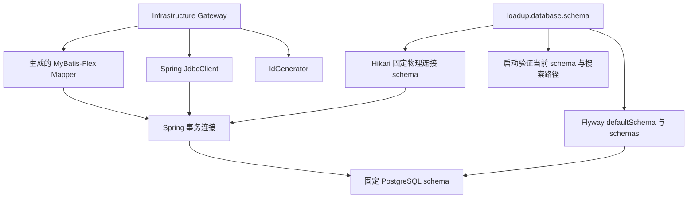

<!-- Generated by doc-sync-agent.py; sources: loadup-components/data/loadup-components-database/README.md, loadup-components/data/loadup-components-database/ARCHITECTURE.md -->

提供 MyBatis-Flex 和 Spring JDBC 集成、PostgreSQL 固定 schema、事务及业务 ID 分配。宿主负责数据源、驱动和业务迁移。

## Maven 依赖

导入 Framework BOM 后添加运行时组件。需要生成 Mapper 的实体模块另行配置 [Database 处理器](../database-processor/)。

```xml
<dependency>
    <groupId>io.github.loadup-cloud</groupId>
    <artifactId>loadup-components-database</artifactId>
</dependency>
```

组件引入 MyBatis-Flex Spring Boot starter，注册框架 Mapper，使用共享 Spring `Clock`，并在单数据源下提供 JDBC 事务管理器。在同一 Spring 事务内，MyBatis-Flex 和 Spring JDBC 使用同一连接，Mapper 可读取未提交的 JDBC 写入，回滚覆盖两种访问方式。

## 固定 schema 与迁移

单个部署使用一个租户和一套固定 schema。`loadup.database.schema` 同时配置连接池和 Flyway。校验规则为 `[a-z_][a-z0-9_]{0,62}`，`public` 和 `pg_` 保留。

```yaml
loadup:
  database:
    schema: customer_a_payment
spring:
  datasource:
    url: ${PAYMENT_JDBC_URL}
    username: ${PAYMENT_JDBC_USERNAME}
    password: ${PAYMENT_JDBC_PASSWORD}
```

- Hikari `schema` 或 JDBC URL 的 `currentSchema` 如有显式配置，必须与目标一致。启动拒绝非空的 Hikari `connection-init-sql` 和 JDBC `options`，包括 Hikari 提供的驱动属性。
- 启动校验 `current_schema()` 和完整 `search_path`。搜索路径只能包含配置的 schema，应用运行账号需获得相应权限。
- 启用 Flyway 时添加 Flyway 和 PostgreSQL 适配工件。通过 `loadup.flyway.locations` 纳入应用自有与获准的模块目录，例如 `classpath:db/migration/pay/admin` 或 `classpath:db/migration/framework/upms`。通用迁移根也会发现依赖 JAR 的匹配资源。
- 组件表模板位于 `db/schema`。在空 schema 初始化时将需要的模板纳入应用迁移。已发布的迁移版本保持内容不变，升级追加新版本。

Task、Scheduler 和 Transfer 使用同一数据源。部署身份通过 `DeploymentIdentity` 表达，锁、AsyncResult 和 DFS 使用各自配置的部署命名空间。

## 持久化接入

1. 在 infrastructure 中定义带 `com.mybatisflex.annotation.Table` 的 DO，继承 `io.github.loadup.components.database.dataobject.BaseDO`。基类包含 id、createdAt、updatedAt 和 deleted，Flex 主键策略为 `KeyType.None`。
2. 在实体模块父 POM 配置编译器处理器。Framework BOM 管理处理器版本，编译器选项由消费工程维护。按处理器文档显式选择 LoadUp、MapStruct 和 Spring Boot 元数据处理器。
3. 用生成的 Mapper、`ServiceImpl<Mapper, DO>` 和 `QueryWrapper` 实现简单筛选、分页和逻辑删除。复杂筛选、`FOR UPDATE`、`IN` 列表及显式列查询通过 infrastructure Gateway 中的 `JdbcClient` 和命名参数完成。可参考 `LoginLogGatewayImpl` 和 `InboxGatewayImpl`。
4. 显式 SQL 自行设置 ID、审计时间和 Boolean `deleted`，查询显式过滤已删除记录。业务表按部署 schema 隔离。MyBatis-Flex 的读写、计数和 `deleteById` 使用统一逻辑删除配置。分页缺省每页 20 条，上限 100。

## 业务 ID 与序列

启用 Sequence 时，默认 `IdGenerator` 为 `BusinessIdGenerator`。持久化写入显式申请 ID。消费应用可以提供单一 `IdGenerator` Bean（如 `UuidV7IdGenerator`）替换默认实现。关闭 `loadup.database.sequence.enabled` 时必须提供替代实现。显式设置的 ID 保留。

Sequence 默认开启。使用前将 `db/schema/sequence_allocation.sql` 作为应用自有版本化迁移纳入 Flyway。每个编码站点应有一个权威分配数据库。故障切换或恢复时保留已提交的分配上界，限制序列行被删除或重置。

```yaml
loadup:
  database:
    sequence:
      enabled: true
      step: 10000
      max-scopes: 1024
      prefetch-threads: 2
      queue-capacity: 256
      wait-timeout: 3s
    business-id:
      data-version: 0
      system-version: 1
      event-code: "00000000"
      extension-code: ""
      site-id: 1
      shard: 0
```

默认元数据为数据版本 0、系统版本 1、事件码 `00000000`、空扩展、站点 000 和分片 000。通用持久化 ID 使用 `00000000`，显式业务生成可使用已登记的事件码。使用默认作用域的实体共享其每日八位容量。独立的发号数据库需明确站点所有权。

注入 `BusinessIdGenerator` 后可复用不可变的命令元数据。

```java
BusinessIdCommand command = new BusinessIdCommand(
        0, 1, "11000000", "", 1, 440);
String businessId = generator.generate(command);
String[] businessIds = generator.generateBatch(command, 100);
BusinessIdParts parts = formatter.parse(businessId);
```

编码顺序为日期（8）、数据版本（1）、系统版本（1）、事件码（8）、扩展（0 至 32）、站点（3）、分片（3）、序列（8）。总长度为 32 至 64，数字保留前导零。每次调用从共享 `Clock` 的时区取一次日期。日期、版本、事件及站点决定分配作用域，分片和扩展共享计数。每个作用域每日最多分配 99,999,999 个号码，含未用完的保留号码。

`shard` 是 000 至 999 的逻辑桶，调用方按稳定路由规则传入，例如按客户路由的版本化散列。需要基于序号路由时组合数值 Sequence 和格式器。分片字段用于业务标识和路由。

需要纯数字时注入 `Sequence`。

```java
SequenceScope scope = new SequenceScope("payment", LocalDate.now(clock), 99_999_999L);
long number = sequence.next(scope);
long[] batch = sequence.nextBatch(scope, 100);
```

热点调用可复用已计算缓存键的 `SequenceScope`。日期为空表示持久作用域。唯一性在单个作用域内成立，最大值首次建立后固定。`nextBatch` 支持 1 至 10,000，可跨不连续区间，失败时不返回部分批次，已消耗号码仍保留。业务幂等复用已保存的 ID。

## 容量与接入检查

正常发号使用内存区间，冷启动和补段需要数据库连接。预取、缓存、独立事务、失败冷却与淘汰策略见 [数据库架构](./#序列分配)。号码允许跳号，业务排序使用自己的顺序字段。

存在共享 `MeterRegistry` 时，组件记录 `loadup.database.sequence.issued`、`loadup.database.sequence.refill` 和 `loadup.database.sequence.failures`。失败指标使用低基数的 `reason` 枚举。部署验收检查固定 schema、数据库权限、冷启动与补段延迟，并演练分配数据库切换和恢复。

需要验证该组件时可执行以下定向测试，数据库 IT 需要 Docker 和 PostgreSQL 容器。

```shell
mvnd clean test -pl loadup-components/data/loadup-components-database -am \
  -Dtest=BusinessIdTest,SegmentSequenceTest,DatabaseSequenceIT \
  -Dsurefire.failIfNoSpecifiedTests=false -Dspotless.skip=true -Dspotbugs.skip=true
```

[数据库架构](./#architecture)

---

<a id="architecture"></a>
## 设计与实现

### 持久化边界

组件为 MyBatis-Flex 和 Spring JDBC 提供持久化约定、共享事务、固定 schema、Flyway 装配以及 ID 和序列能力。宿主选择数据源、驱动和部署迁移。简单查询由生成 Mapper、`ServiceImpl` 和 `QueryWrapper` 处理，复杂筛选、加锁、条件更新与批处理使用参数化 JDBC。



`BaseDO` 维护公共字段。MyBatis-Flex 保留应用指定的 ID。审计时间使用共享业务 Clock 及其时区。

| 字段 | 列 | 类型 | 行为 |
| --- | --- | --- | --- |
| `id` | `id` | `VARCHAR(64)` | 显式赋值，Flex 主键策略为 `KeyType.None` |
| `createdAt` | `created_at` | `TIMESTAMP(6)` | 插入时写入 |
| `updatedAt` | `updated_at` | `TIMESTAMP(6)` | 插入与更新时写入 |
| `deleted` | `deleted` | `BOOLEAN` | false 为有效，true 为已删除 |

`MyBatisFlexCustomizer` 统一逻辑删除、分页缺省值和 banner 设置。带 `deleted` 列的 Mapper 按全局约定读写，显式 SQL 自行设置审计字段及筛选删除标记。

### 编译生成与事务

[注解处理器](../database-processor/#architecture) 维护唯一的生成策略。每个 `@Table` 实体会得到上一级包下的 `mapper.XxxMapper` 与 `table.XxxTableDef`，表定义汇总于 `Tables`。Mapper 带 `@Mapper` 并继承 `BaseMapper<XxxDO>`。处理器输出与运行时配置各由对应工件维护。

自动配置扫描 `io.github.loadup` 下的 `BaseMapper` 子类型。存在单个数据源且 Gateway 注入时，懒加载的 Mapper 初始化。会话工厂优先复用其 DataSource 或 Flex 包装的单一 DataSource 上的 Spring 连接，其他情形使用 Flex 的默认事务行为。MyBatis 本地缓存为 `STATEMENT`，避免同一事务中 JDBC 更新后读取到会话缓存的旧数据。

### 固定 schema 与迁移归属

`FixedSchemaEnvironmentPostProcessor` 对齐连接池的 schema，拒绝不一致的显式 schema 和可改变连接初始状态的配置。`FixedSchemaVerifier` 在 Worker 等后台执行器开始前验证 `current_schema()` 与完整 `search_path`。请求和后台任务共用固定数据源，部署身份与连接目标分别配置。

数据库角色负责实际访问边界。迁移与运行账号按部署分权，跨 schema 权限需在目标数据库验收。非关系存储按部署配置自己的命名空间。

`LoadUpFlywayAutoConfiguration` 将相同 schema 应用于 `defaultSchema` 和 `schemas`。应用选择明确的迁移位置，每个应用的所选脚本共享一个历史记录。脚本使用当前 schema 下的未限定表名，已发布版本保留原内容。

### 序列分配

`BusinessIdGenerator` 在 Sequence 可用时提供默认应用 ID。Sequence 通过 Spring JDBC 以独立的 `REQUIRES_NEW` 事务预留区间，按 schema 内唯一 `scope_key` 更新分配上界，业务回滚后号码仍然有效。

每个作用域持有一个活跃区间和最多一个备用区间，剩余 20% 时开始预取。热路径用原子操作领取号段中的号码，并发冷启动共享一次分配。初始化和死锁等短暂故障在新事务中有限重试并加入抖动。预取失败保留当前区间，失败冷却抑制重复分配请求。队列拒绝、超时、容量耗尽、最大值不一致和作用域接纳失败通过带 `DatabaseResultCodeEnum` 的 `CommonException` 报告。

作用域达到上限时可清理过往日期的缓存。未用号段丢弃，已在运行的分配可能提交但对新的缓存条目不可见。常驻与当前日期作用域保留，超出的请求返回错误。关闭应用会停止预取并结束未完成的等待。

[接入、配置与业务 ID 格式](./)
