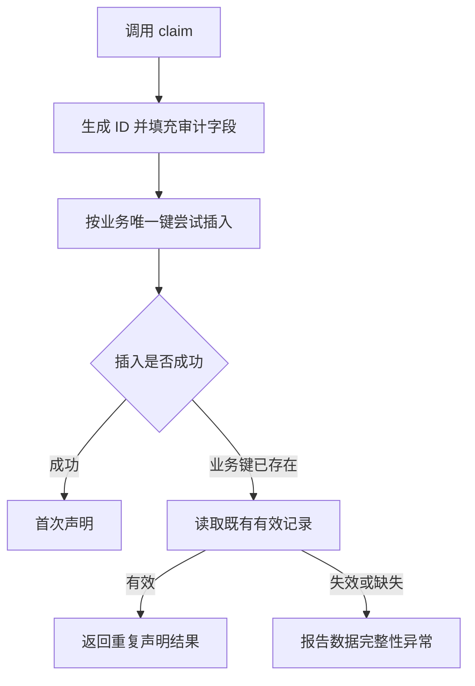

<!-- Generated by doc-sync-agent.py; sources: loadup-components/reliability/loadup-components-globalunique/README.md, loadup-components/reliability/loadup-components-globalunique/ARCHITECTURE.md -->

基于 PostgreSQL 唯一索引的租户级幂等声明组件；单一 jar 随应用部署，业务侧只注入 `GlobalUniqueTemplate`。

## 引入

```xml
<dependency>
    <groupId>io.github.loadup-cloud</groupId>
    <artifactId>loadup-components-globalunique</artifactId>
</dependency>
```

## 使用

```java
@Transactional
public void createOrder(OrderCreateCommand command) {
    var claim = new GlobalUniqueClaim("ORDER_CREATE", command.orderNo(), command.orderNo(), null);
    if (!globalUniqueTemplate.claim(claim)) {
        return;
    }
    // Business writes must use the same transaction.
}
```

## 配置

```yaml
loadup:
  global-unique:
    enabled: true
  database:
    schema: loadup_payment  # fixed business schema
      enabled: false
  flyway:
    locations: classpath:db/migration
```

API 在本部署范围内声明幂等键；数据库唯一维度为 `biz_type + unique_key`，不含 `tenant_id`。一套部署只服务一个租户并固定使用
`loadup.database.schema`，因此幂等记录天然只属于该部署。组件显式设置
ID、审计时间和删除标记。数据库隔离现状见 [database README](../database/)。

## 能力矩阵

| 能力                           | 支持                     |
|--------------------------------|--------------------------|
| 当前 schema 内并发幂等         | ✓ PostgreSQL 唯一索引   |
| 业务元数据、请求快照、记录查询 | ✓                       |
| 事务回滚后重试                 | ✓ 同一 Spring 事务      |
| ID、审计、逻辑删除             | ✓ database 组件统一提供 |
| 过期、自动归档、缓存           | ✗ 由业务维护            |

---

<a id="architecture"></a>
## 设计与实现

### 业务键与存储

`GlobalUniqueTemplate` 提供同一部署内的幂等声明。组件维护 PostgreSQL `global_unique` 表，以 `UNIQUE (biz_type, unique_key)` 作为最终裁决。Database 组件提供 ID 生成及固定 schema，记录按部署隔离。



业务类型和唯一键先去除首尾空白，再校验非空和长度上限，分别为 64 和 255 个字符。`bizId` 和 `requestData` 用于诊断，唯一性由业务类型和唯一键决定。插入使用 PostgreSQL `ON CONFLICT (biz_type, unique_key) DO NOTHING`，其他约束错误继续向上传递。

### 事务边界

组件通过 Spring JDBC 使用 Spring 管理的连接。调用方需将声明与业务写入放入同一事务，才能随业务失败一起撤销。独立调用的声明会单独提交。仓储读取显式过滤 Boolean 逻辑删除标记。

[依赖和表迁移](./) · [数据库 schema 与事务](../database/#architecture)
