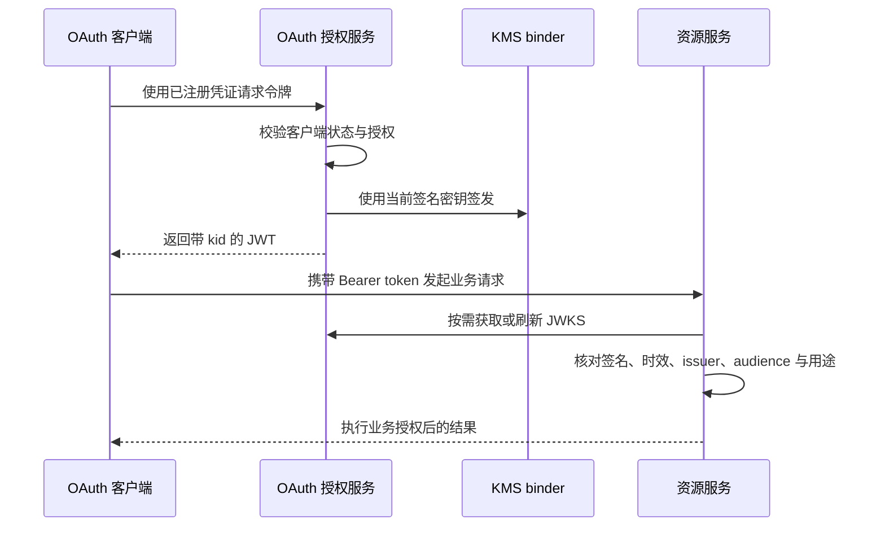

<!-- Generated by doc-sync-agent.py; sources: loadup-components/security/loadup-components-oauth-server/README.md, loadup-components/security/loadup-components-oauth-server/ARCHITECTURE.md -->

统一 OAuth2 授权服务器、JWT 资源服务器与可选的标准 JDBC 存储集成。

| 能力 | 开关或接口 | 约束 |
| --- | --- | --- |
| KMS 签名与公钥发布 | auth-server.enabled | KMS 保存私钥，组件只发布公钥 |
| OAuth2/OIDC 协议 | auth-server.protocol-endpoints-enabled | 应用选择通用协议或专用链 |
| 资源端验证 | resource-server.enabled | 签名、时效、issuer、audience、token_use |
| 客户端数据库管理 | RegisteredClientRepository | 不执行启动配置同步 |
| 授权及同意持久化 | oauth.persistence.enabled | Spring 标准 JDBC 实现 |
| 业务 claims | OAuth2TokenCustomizer | 应用负责身份与授权语义 |
| 客户端生命周期 | OAuthClientManager | 标准注册字段、策略校验、停用与凭证轮换 |

引入 `loadup-components-oauth-server-core` 使用实现；只需身份契约的消费者引入 `loadup-components-oauth-server-api`。
开关完整前缀为 `loadup.security`。资源服务只需要：

```yaml
loadup:
  security:
    resource-server:
      enabled: true
      issuer-uri: https://issuer.example
      audience: orders
```

独立授权服务还需启用 `auth-server.enabled`，配置 issuer、audience、KMS signing key；启用 JDBC 时显式引入 JDBC/Flyway/数据库驱动并加入 `classpath:db/loadup-oauth`。
协议链不读取 YAML 客户端目录。管理方通过 `OAuthClientManager` 创建和更新注册；它使用 Spring `RegisteredClient` 作为授权字段输入，并负责生成和散列客户端凭证。不要直接将此管理对象暴露为未经保护的 HTTP API；嵌入它的管理边界必须认证并授权调用者。

### 签名密钥轮换

配置 `loadup.security.auth-server.signing.active-key.name` 即可按 alias 签发 JWT。省略 `version` 或设为 `0` 时，签发端每次读取当前公钥，JWT 的 `kid` 为 `alias.公钥指纹`。JWKS 通过 KMS binder 查询并发布该 alias 的当前及历史公钥。显式正整数版本沿用 `alias-vN`，升级前签发的此类 JWT 可通过 `signing.verification-keys` 保留原来的公钥引用。

每个 binder 从后端读取仍受信任的历史公钥，OAuth Server 可以在重启后重新发布 JWKS。保留旧密钥的验签权限或公钥至少到旧 JWT 到期。

详见 [架构](./#architecture)、[API](../oauth-server-api/)、[Core](../oauth-server-core/)。

---

<a id="architecture"></a>
## 设计与实现

### 发布边界

组件只有 `loadup-components-oauth-server-api` 和 `loadup-components-oauth-server-core` 两个发布模块。
API 提供轻量身份接口 `LoadUpSubject`、客户端元数据键 `OAuthClientSettings` 及客户端管理请求/响应契约，不创建 Bean，不依赖 SAS 或 KMS。
Core 包含授权端签发、资源端验证、标准 JDBC 持久化、配置绑定及全部测试。
`authserver` / `resourceserver` Java 包表达不同协议角色；模块合并不合并安全链或令牌信任范围。

### 独立装配

- `loadup.security.auth-server.enabled=true`：启用 KMS 签发、JWKS/settings；缺省关闭。
- `loadup.security.auth-server.protocol-endpoints-enabled=true`：在签发启用基础上提供通用 OAuth2/OIDC 协议链；关闭可由应用提供专用协议链，或只使用 encoder。
- `loadup.security.resource-server.enabled=true`：只启用资源端 JWT 校验；不要求 KMS、客户端库或授权数据库。
- `loadup.security.oauth.persistence.enabled=true`：存在同源 JDBC/事务管理器及共享 Clock 时提供客户端、授权、同意记录存储；缺省关闭。

Core 直接依赖 Spring Security OAuth2 库，不引入 Boot Authorization Server starter，避免仅引入组件就触发 Boot 默认授权服务装配。
JDBC 和 Boot SQL 依赖可选；应用主动引入 JDBC starter。协议签发与资源端同时启用时，资源端 decoder 负责 issuer/audience/token_use；本地签发 decoder 不覆盖它。同一应用同时签发和验签、且 issuer 相同且未显式指定外部公钥/JWKS 时，资源端直接使用本地公钥，但仍完整校验 issuer、audience、时效和用途。

### 签发与访问受保护资源



### 标准接口与数据所有权

协议客户端存储使用 `RegisteredClientRepository` / `RegisteredClient`；授权和同意使用 `OAuth2AuthorizationService` / `OAuth2AuthorizationConsentService`。实现分别为 Spring 的 JDBC 实现，允许通过标准 Bean 替换。
`OAuthClientManager` 在标准注册字段上提供创建、授权更新、停用、凭证到期设置和凭证轮换。创建与轮换由服务端生成 32 字节随机 secret，以 URL-safe Base64 无填充字符串形式返回一次，并只把密码编码器生成的散列写入标准客户端记录。`IssuedClientCredential.toString()` 隐去 secret；调用者仍须避免读取后记录、持久化或回显明文。
创建模板必须使用标准 `RegisteredClient` 字段且不带 secret 或 secret expiry。注册 ID 与 client ID 创建后不可更新。授权更新只改授权字段并保留凭证状态；停用客户端不会因凭证轮换而重新启用。凭证轮换立即替换单一有效 secret，没有新旧凭证并行窗口。`setCredentialExpiry` 允许设置过去时间以立即使凭证失效。
`get` 返回可供管理读取的标准注册信息，但会清除 secret hash。组件没有启用/重新启用操作；授权更新会保留现有的 enabled 状态。
不另造协议 CRUD、YAML 注册目录或启动同步 SPI。`OAuthClientSettings.ENABLED` 与 `AUDIENCE` 是可选元数据键，具体业务策略由应用实现 `OAuthClientPolicy` 验证，Pay 的策略只属于 Pay 应用。

`LifecycleRegisteredClientRepository` 作为协议视图，在所有标准客户端查找中排除已停用或 secret 已过期的注册。签发时 `OAuthClientTokenValidator` 再读取当前客户端记录，并校验当前有效状态、secret、grant 和 scope；更改授权后不会继续用旧认证快照签发。
客户端管理更新使用本地 JDBC 事务，并对目标客户端行执行 `FOR UPDATE`，以串行化同一记录的并发管理变更；没有启动期全局注册锁。自动装配管理器要求单一 `DataSourceTransactionManager`（包括其 `JdbcTransactionManager` 子类）、同一 DataSource 上的 JDBC 操作及框架共享 Clock。管理更新不修改标准 OAuth 表结构。

管理器不是公开管理 HTTP API。任何嵌入 `OAuthClientManager` 的控制器、作业或运维进程都必须自行认证并授权调用者。此版本不集成 OpenBao KV 保存/交付客户端 secret；KMS 的 JWT 签名路径保持不变。凭证轮换或停用只阻止后续认证和签发，已签发 JWT 仍可验证直到各自到期。
业务身份和 claims 通过标准 `OAuth2TokenCustomizer<JwtEncodingContext>` 定制。框架不强制租户字段，也不依赖商户、Pay 权限或用户目录。

数据库是客户端授权的唯一持久化来源。应用启动不导入配置、不覆盖客户端、不轮换凭证、不清理目录，因此没有启动注册同步锁。
密钥散列、grant、scope、redirect URI、有效期等使用标准模型；OAuthClientManager 负责生成和散列凭证，管理边界负责审批授权。
修改数据库授权只影响后续签发；已签发 JWT 的本地验证不提供即时撤销。

### 数据库迁移

Core 提供 PostgreSQL 协议表迁移位置 `classpath:db/loadup-oauth`，包含客户端、授权和同意表。
迁移资源放在默认 db/migration 扫描目录之外，由应用显式纳入 Flyway locations，不自动执行初始化 SQL。原始注册/授权迁移内容及版本描述保持不变，以保留既有 Flyway 校验值。
Pay 特定的旧 settings 清理由 Pay 自身迁移负责。

### 测试

全部单元和集成测试位于 core/src/test，旧独立测试模块与资源端测试均迁入此处。
已有的 KMS 边界测试及测试说明保留。数据库集成验证、签发/验签验证需在本地运行，静态检查不能代替它们。

管理变更在 client settings 中递增内部 revision（无需新增表列）。协议认证中的密码散列升级同样锁行并核对 revision，旧认证快照不能覆盖刚发生的停用、轮换或授权修改。散列重编码不改变 revision；签发前检查的是管理版本，避免将同一密码的并发重编码误判为凭证轮换。低层 RegisteredClientRepository 写入口用于协议集成，管理变更统一调用 OAuthClientManager。

创建时尚无可锁定的行，因此在 PostgreSQL 事务内分别锁定 client ID 与注册 ID（按固定顺序的标识级 advisory lock），防止标准仓储 upsert 覆盖并发创建；唯一索引继续作为最终约束。修改已有记录使用行锁。这些锁只覆盖单次管理操作，不存在启动目录同步或全局注册锁。

版本 0 的签名始终按 alias 选择当前密钥。动态 JWKS 通过 `KmsTemplate.verificationKeys(alias)` 读取仍受信任的版本，公钥指纹组成 JWT 的 `kid`。
