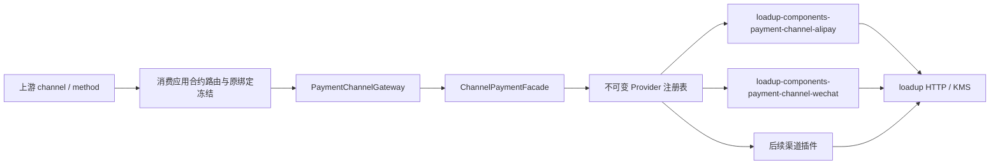

<!-- Generated by doc-sync-agent.py; sources: loadup-components/integration/loadup-components-payment-channel/README.md, loadup-components/integration/loadup-components-payment-channel/ARCHITECTURE.md -->

支付渠道组件采用 **Facade + Strategy + Registry + Adapter**，位于 LoadUp Framework 的 `integration/` 分类下。
消费应用（当前为 LoadUp Pay 的 payment 服务）维护业务执行状态、选路资源和资金证据；本组件维护渠道 SPI、路由引擎、
厂商协议与凭证。渠道与支付方式是两个维度：上游指定 ALIPAY/WECHAT，消费应用在合约和商户绑定允许范围内冻结选路；
PAYMENT_CODE/JSAPI/H5 决定该渠道的交互方式。

本组件是 **支付收单渠道组件**，不是与厂商无关的通用 channel 框架：API 中的账户身份、动作类型和错误码按支付宝/微信
收单语义建模。新增厂商应增加 binder，而不是把厂商报文塞进 core。

| Maven 坐标 | 职责 | 当前实现 |
|---|---|---|
| `loadup-components-payment-channel-api` | Facade、三类 Provider SPI、`ChannelActionCodec` 门面与 `ChannelActionTypeCodec` SPI、不可变请求/结果与绑定契约、渠道错误码 | 源码；零 Spring/数据库/Pay 业务依赖 |
| `loadup-components-payment-channel-core` | Default Facade、不可变策略注册表、统一结果核验、`RegistryChannelActionCodec`、自动装配 | 按 channel 路由；重复 Provider/kind/type 启动失败 |
| `loadup-components-payment-channel-alipay` | 支付宝协议、签名验签、版本化凭证、支付/退款/通知适配 | OpenAPI v2/RSA2；服务商 H5 待补 |
| `loadup-components-payment-channel-wechat` | 微信 V2 付款码与 APIv3 支付/退款/通知/账单适配 | 付款码撤销补偿待补 |

```xml
<dependency>
  <groupId>io.github.loadup-cloud</groupId>
  <artifactId>loadup-components-payment-channel-api</artifactId>
</dependency>
```

消费应用只编译依赖 `-api`，并在启动模块以 `runtime` scope 引入 `-core` 和所需厂商 binder。组件不引入独立部署单元，
也不要求测试 RPC。

## 调用与依赖

```text
上游 PaymentChoiceDTO(channel, method) + 已准入合约的 routingProfileRef
  -> payment 业务编排 / 冻结 bindingRevisionId + accountScopeHash
  -> payment-domain: PaymentChannelGateway
  -> payment-infrastructure: PaymentChannelGatewayImpl
       -> 以可信租户读取原不可变 binding revision
       -> loadup-components-payment-channel-api: ChannelPaymentFacade
       -> loadup-components-payment-channel-core: Registry[channel]
       -> loadup-components-payment-channel-alipay / loadup-components-payment-channel-wechat: ChannelProvider 策略
       -> loadup HttpTemplate / KmsTemplate
```

渠道 API、引擎和适配模块均不依赖 Pay 的 client/domain/app/infrastructure。当前 payment-domain 与 payment-infrastructure
只编译依赖 `loadup-components-payment-channel-api`，通过构造器注入统一 Facade；payment-bootstrap 通过 runtime 依赖显式装配
`loadup-components-payment-channel-core` 和厂商 binder。组件随消费应用进程运行，不增加独立部署单元或测试 RPC。

模块依赖、模式职责与扩展步骤见 [渠道架构](./#architecture)。

上游调用示例中的支付选择为 `"choice": {"channel": "WECHAT", "method": "H5"}`，
切换为支付宝时由上游传入 `ALIPAY`。`bindingCode`、直连/服务商模式和实际收款账户由已准入合约的
路由配置与商户绑定确定，不接受调用方直接指定凭证或绑定版本。Facade 不维护厂商分支：Spring 收集
`ChannelProvider`，注册表按冻结的 channel 查找策略。

`PaymentChannelModuleBoundaryTest` 检查本组件源码边界：API 不依赖 Spring 或厂商实现；core 不引用厂商 binder；binder 不引用
core、其他 binder 或 `io.github.loadup.pay.*` 业务包；各模块的 `AutoConfiguration.imports` 只注册自身配置。
消费应用的装配边界（payment 业务模块只依赖 API、bootstrap 以 runtime 引入实现）由消费应用自己的门禁维护。

Facade 路由用例覆盖策略注册顺序变化、选定渠道异常时禁止向另一渠道提交；Boundary/路由测试纳入本模块的单元测试门禁。

## 统一 API

`ChannelPaymentFacade` 提供九个操作：

| 操作                           | 输入与语义                                                                                       |
|--------------------------------|--------------------------------------------------------------------------------------------------|
| validate(context, validation)  | Y2 前核验插件/支付方式/参数与冻结账户；不授予执行 epoch，不进行 HTTP、KMS、文件或资金操作        |
| submit(context, request)       | 原执行信息＋订单标题/截止时间＋绑定明文输入；返回 ChannelPaymentSubmission，将动作与资金事实分开 |
| query(context, target)         | ChannelPaymentTarget 包含原身份与原金额；查询原渠道原账户下的原请求                              |
| recover(context, recovery)     | 只查询原交易，返回验签观察与可恢复的有效动作；无原输入或提交许可，不重新创单/扣款                |
| close(context, target)         | 同一原身份/原金额下收敛关闭；调用方负责先持久化关闭门禁，不能把超时视为未收款                    |
| canRefund(refund)              | 纯本地能力查询；允许在业务事务内调用，不读取绑定、文件、KMS 或网络                               |
| submitRefund(context, refund)  | 原交易、原请求号、退款金额与固定退款请求号                                                       |
| queryRefund(context, refund)   | 只查询同一退款，不重建或改路由退款请求                                                           |
| recoverRefund(context, refund) | 查询原退款；仅在渠道明确幂等保证与特定验签条件下重提原号原参数，不创建新退款身份                 |

`ChannelExecutionContext` 包含可信 tenantId 与调用方解析的不可变 `ChannelBindingRevision`。
Facade 在调用策略前校验租户、channel、bindingRevisionId、accountScopeHash；submit 还校验绑定的支付方式能力。
所有结果必须匹配原身份和原金额；退款还必须匹配原交易号/退款号。外部调用禁止在本地事务中执行。

没有对应 Provider、插件未启用或不支持能力时明确返回 CHANNEL_UNSUPPORTED_CAPABILITY；不回退到另一渠道或账户。
查询/关闭/退款复用原 revision，不重新读取当前活动路由，不因商户后续切换凭证而改变在途交易身份。

## 新增渠道

1. 新建 `loadup-components-payment-channel-{vendor}`，仅依赖 `loadup-components-payment-channel-api` 与实际需要的 loadup 组件。
2. 实现 `ChannelProvider`，用 `channel()` 声明唯一渠道；直连/服务商模式由该策略按冻结绑定处理。
3. 为该厂商的每个动作类型实现 `ChannelActionTypeCodec` 并在插件 AutoConfiguration 中注册 Bean。kind 与 actionType 必须唯一。
4. 用插件自身的 Spring Boot AutoConfiguration 条件注册 Provider 和动作 codec；不同渠道可同时加载。binder 不声明跨模块
   `afterName`，Provider 与 codec 由 core 通过 `ObjectProvider` 收集，装配顺序不影响注册表。
5. 在应用 bootstrap 组合插件和配置，新增路由无需修改 `loadup-components-payment-channel-core` 的分支、工厂或 codec switch。
6. Provider 对响应验签、实际收款账户、金额和状态负责；未知结果保留 UNKNOWN，不制造成功或未收款证据。

支付宝插件启用时注册 AlipayChannelProvider，已实现退款提交/查询、支付查单和未付款关闭的协议映射；付款码与 JSAPI 提交已补源码，H5
仍明确拒绝未实现能力。微信已条件注册 JSAPI/H5/查单/关闭与普通退款 Provider，支付与退款异步通知也已有接线；付款码仍未实现。后续在独立插件内补齐支付宝
H5 与微信付款码等能力；支付宝验签回调已有源码；payment 自动提交/查单/关闭驱动已有源码，仍需后续验证；银联产品与接入机构仍待确认。源码接入不等于真实资金链路验收通过。

本批只调整源码、依赖、文档与测试源码。按用户要求，未运行 IDE 检查、构建、测试、迁移、部署或真实渠道操作。

支付 query/close 已统一采用 ChannelPaymentTarget，不保留旧 bare identity 重载。PaymentObservation.Source 新增
CLOSE_RESPONSE，区分关闭的组合证据和单独查询。支付宝单独 TRADE_CLOSED
不产生未收款证明，详见 [支付宝协议语义](../payment-channel-alipay/)。

## 提交请求与结果

ChannelPaymentRequest 包含 PreparedChannelPayment、原 subject、原 payableUntil 和隐藏诊断的
ChannelPaymentInput。输入按付款码、已解析渠道买家标识、H5 终端场景、无输入四类建模；不能将 OAuth 授权码当成
buyer_id/open_id。ChannelPaymentSubmission 包含原身份/金额、可空的验签观察和可空动作，至少有一项；有动作时观察只能为受理，不得同时宣称支付成功。动作的渠道、支付方式和有效期由
Facade 与原请求核验。

payment 的 PaymentChannelRequestFactory 在事务外核对原 SUBMITTING attempt、执行 epoch、风控/额度许可与调用方/原金额，再读取单
attempt 绑定的短期密文输入；通过 MapStruct 转为渠道请求。独立渠道模块不反向读取 payment 的库或解密接口。当前提交协议、动作持久化与
payment 授权查询/幂等受理返回已有源码；主链自动驱动已有源码，托管 cashier 交互仍待完成。

## 模式与扩展边界

- Facade：上游仅调用 ChannelPaymentFacade，统一提交、查单、关单及退款契约。
- Strategy：每个渠道实现一个 ChannelProvider；直连/服务商、商户/子商户由该策略根据冻结账户身份处理。
- Registry：Spring 收集 Provider，启动时构造不可变 Channel→Provider 注册表；重复渠道注册立即失败，无厂商 switch/if 选路。
- Adapter：PaymentChannelGatewayImpl 适配 payment 的领域端口；各插件内部再适配厂商协议与 loadup HTTP/KMS 组件。

上游 channel 不是任意绕过合约的开关：payment 先校验合约和商户绑定，冻结
channel、method、bindingRevisionId、accountScopeHash。Facade 按请求 channel 查注册表，再校验同一冻结账户。新增厂商协议不得放入
payment 的业务 Service 或 GatewayImpl。

动作格式由 `loadup-components-payment-channel-api` 的类型契约声明。厂商 binder 提供 `ChannelActionTypeCodec`，负责自身动作的严格
JSON；core 的 `RegistryChannelActionCodec` 负责 kind/type 唯一性、8 KiB 上限、SHA-256 摘要和未知 kind 拒绝，不接受任意类名。
payment 保存动作快照并将已定义的动作投影为客户端 DTO，不解析厂商响应或生成渠道支付参数。动作投影属于表示映射，不参与渠道选择。

payment_action 与 Y3 受理回执在同一事务记录；重复结果保留首次动作，不能更换交易号或延长期限。动作只在原 active attempt、原执行
epoch、PROCESSING、双门禁 OPEN 且未过期时返回，终态或封禁后隐藏。调用方持锁仅处理本地状态；真实渠道调用仍在事务外。动作存储已由首次提交的自动执行器调用；JSAPI
创建动作响应丢失的查询恢复已有源码；关闭 ACK 丢失的确定证据仍待补齐。

## Y2 前预检

ChannelPaymentValidation 携带原身份/金额、method、subject、payableUntil 和短期输入，刻意不带 executionEpoch。Facade 通过同一
Provider 注册表调用 validate；该方法只做能力与参数校验，不能发送 HTTP、加载文件、解密 KMS 或产生任何交易。解密由 payment
在事务外校验原未绑定输入后进行，明文仅传给本地策略。

支付宝 validate 与 submit 共用参数规则；尚未实现的 H5/微信付款码、错误付款码、错误应用作用域或不符合渠道时间窗的请求在额度申请/Y2
之前拒绝。拒绝时仍需在原门禁下核实 attempt 没有进入 Y2，才能生成本地无收款证明；并发赢家已经进入 Y2
时改为查询原交易。预检通过不保证后续网络成功，也不授权任务重试重新扣款。

## 查询恢复唤起动作（2026-10-23）

ChannelPaymentRecovery 冻结原 identity/amount/method/executionEpoch/payableUntil，不带付款码、买家标识、preparedInputRef
或提交 ticket。它与 PreparedChannelPayment 共享只读 ChannelPaymentExecution 元数据接口；该接口本身不授予提交权。Facade 的
recover 仍走 Provider 注册表，核验原身份/金额、QUERY_RESPONSE 来源与动作方式/期限，无厂商路由分支。

支付宝插件通过同一 out_trade_no 查询，只有已验签 WAIT_BUYER_PAY、原金额/交易号核验通过、原 method=JSAPI 且原截止时间未到才重建
AlipayJsapiChannelAction。动作到期使用原 payableUntil 按秒向下取整，与首次 CREATE
一致；不会从恢复时间重新计时。付款码、已成功、未知、已关闭或过期只返回资金观察，不产生动作。recover 不调用
CREATE/PAY，也不依赖原短期付款输入仍可解密。

payment 恢复任务通过 MapStruct 从原 attempt/冻结期限构造查询上下文，调用 recordRecovery 将查询观察和动作放入同一 Y3
事务。action 仍遵守原 payment 状态、当前 attempt/epoch 和双门禁的读取规则；已有首份动作不能被新交易号或更晚有效期覆盖。payment
已经进入 UNKNOWN 时保留原保守状态/可见性规则，不靠一条中间观察强行回退到 PROCESSING。

新增契约、插件/编排/桥接与测试源码，未运行构建、测试或真实渠道调用；这不解决没有确定未收款证据的关闭 ACK 丢失，也不完成
H5/微信或真实回调。

## 独立回调策略（2026-10-24）

ChannelNotificationFacade/ChannelNotificationProvider 与支付 Facade 共用同一独立模块边界，通知策略单独按 Channel
注册。identify 只产生不可信原请求号提示；verify 必须持可信租户与原冻结绑定，核验签名、原身份和金额，返回
VerifiedChannelNotification 查询触发元数据，不返回金融终态。固定 ACK 由策略提供，payment 不拼装支付宝协议字符串。

支付宝插件已补 UTF-8 form/RSA2 解析和验签：64 KiB 收包上限、重复字段/非法百分号/非法 UTF-8 拒绝，未知非空字段也参与签名；排除
sign/sign_type 后按字段排序。验签后核对原 out_trade_no、app_id、seller_id、total_amount 和通知类型，绑定原
trade_no。公钥来自原版本描述文件，验签本身不读取商户私钥或解密服务商授权；后续原号查证仍按原凭证版本调用渠道。

payment 回调入口先由配置 endpointRef 定位 tenant/binding revision，不能由请求头/参数选择租户；验签成功后锁外 query 原交易，归一为
CALLBACK 来源观察，再沿原 Y3 记回执/资金事实/Outbox。回执键绑定 notify_id 与权威查询事实摘要，允许同一触发的未知→成功查证推进；重复相同金融事实不重复应用。ACK
只在 Y3 返回已提交且非 CONFLICT 后产生，异常返回失败 ACK。验签通知的 trade_status 不直接决定付款金额或终态。

依据：[官方异步通知与验签规则](https://developer.alibaba.com/docs/doc.htm?articleId=105301&docType=1&treeId=193)、[官方 Java 验签实现](https://github.com/alipay/alipay-sdk-java-all/blob/master/v2/src/main/java/com/alipay/api/internal/util/AlipaySignature.java)
。源码/测试源码已补，未运行构建、测试、数据库或真实渠道验收；微信/银联通知和退款外部通知仍待实现。

## 微信 JSAPI 策略（2026-10-24）

独立微信插件已有直连/服务商 JSAPI 下单、原号查询/恢复/关闭与 KMS 唤起签名源码。ChannelPaymentAction 新增
WechatJsapiChannelAction，core 白名单编码与 payment MapStruct 客户端投影同步，复用既有动作持久化、可见性和 RPC DTO。固定
HTTP operation、原版本凭证和必填可信通知地址在插件内维护。微信 query-only recover 不重新下单，预支付 ACK
丢失时暂不能重建动作。退款/H5/付款码/通知与实际接入继续待办，详见 [微信插件](../payment-channel-wechat/)；未运行编译、测试或真实资金验收。

微信普通退款已接统一 Provider，直连/服务商保持原 transaction_id、out_trade_no、out_refund_no、sub_mchid 与 gross
金额；申请只受理，查询确认成功/关闭，ABNORMAL/不存在不释放容量。沿用 payment 的固定计划/恢复任务/退款回执与金融结果落库，没有新增
vendor 路由或业务表。新增固定退款 operation 与源码测试，未运行编译或真实资金验证；异常退款处置、未达渠道时的原号重提及微信通知继续待办。

## 加密通知与原生 ACK 契约（2026-10-24）

ChannelNotificationOperations.identify (context,input) 现在取得可信原绑定，以支持微信加密订单定位；payment
Gateway.identify 传原 channel/revision，先加载原绑定，不让请求选择租户/密钥。ChannelNotificationInput
新增不可变多值签名头；ChannelNotificationAcknowledgement 新增 httpStatus，控制器原样返回策略状态和固定报文。支付宝成功/失败仍为
HTTP 200 success/failure，微信支付通知为 Y3 提交后 200 SUCCESS、失败 500 FAIL。不保留旧参数重载。

微信支付通知已接原字节验签、APIv3 KMS
密文解封/AES-GCM、原账户/金额/订单核验与原号查证。退款通知、轮换策略和实际回调验收仍待办，见 [微信通知设计](../payment-channel-wechat/)。

退款通知已接统一通知策略的独立 identifyRefund/verifyRefund，复用微信验签/解密，分别核验原退款身份/总额/本次退款额；payment
独立退款入口在验签后查原退款，并复用原退款结果事务/ACK。支付宝退款通知尚无策略实现。退款与收款 URL 按原 tenant/revision
分开配置，微信退款回调源码细节见 [微信插件](../payment-channel-wechat/)；未运行验证或真实回调。

## 原号退款恢复（2026-10-24）

recoverRefund 与 queryRefund 分开：回调和纯查询继续使用 queryRefund；原生退款恢复任务使用 recoverRefund。统一 Facade 仍按原
channel/revision/账户作用域路由并核验原退款身份/金额；恢复只接受 QUERY_RESPONSE，或非终态 ACCEPTED/UNKNOWN 的
SUBMIT_RESPONSE，不能把重提受理当退款成功。payment 的 INIT 首次赢家仍仅调用一次 submitRefund，其后原状态/固定计划交渠道策略恢复，没有厂商分支。

微信只有验签的 HTTP404 RESOURCE_NOT_EXISTS 才按原请求号/原交易/原金额重提一次；支付宝只有验签 code10000、原三项自然键齐备匹配且
refund_status
缺失，附带金额核验后才原号重提。各自依靠官方原退款号幂等保证，不把缺失/不存在当未退款证明。错误、异常状态或已有终态不触发重提；查询异常/验签失败不提交。重提结果用查询与提交摘要组成恢复证据，资金占用保留到原查询金融终态。详见各插件说明。源码/测试源码已补，未运行构建或真实退款。

## 组件边界门禁

`PaymentChannelModuleBoundaryTest` 检查本组件的源码边界：API 不依赖 Spring 或厂商实现；core 不引用厂商 binder；binder
不引用 core、其他 binder 或任何 Pay 服务包（`io.github.loadup.payment/acquire/realtime/...`）；每个模块的
`AutoConfiguration.imports` 只注册自身配置。
消费应用的跨服务 POM/源码门禁仍由消费应用维护，不随组件迁移进入 Framework。

## Review R3：共享渠道恢复并发预算

loadup-components-payment-channel-core 新增 ChannelRecoveryConcurrency，复用 LoadUp ResilienceRegistries/BulkheadRegistry，不创建自有线程池、信号量平台或渠道专属分支。
DefaultChannelPaymentFacade 在原 tenant/binding/能力校验后，对 query、recover、close、queryRefund、recoverRefund 使用每渠道共享预算。
单个 Provider 内部可能执行多步查证或原号幂等退款恢复，整个操作占一个预算；不是逐 HTTP 请求限流。

| native Bulkhead 实例          | payment 业务服务 默认并发 | 环境变量                                 |
|-------------------------------|---------------------------|------------------------------------------|
| payment-channel-recovery-alipay   | 16                        | PAYMENT_ALIPAY_RECOVERY_MAX_CONCURRENT   |
| payment-channel-recovery-wechat   | 16                        | PAYMENT_WECHAT_RECOVERY_MAX_CONCURRENT   |
| payment-channel-recovery-unionpay | 16                        | PAYMENT_UNIONPAY_RECOVERY_MAX_CONCURRENT |

配置沿用标准 resilience4j.bulkhead.instances.*.max-concurrent-calls，max-wait-duration 固定 0ms，启动拒绝非零等待配置。
实例名只由 Channel enum 生成，不包含租户/订单/账户/请求号。未实现 Provider 仍由原策略注册表拒绝，不因配置预算而变成支持。

满额立即抛固定 CHANNEL_RECOVERY_BUSY，进入调用方既有依赖重试；不调用 Provider、不换渠道、不创建新的金融请求，也不释放占用。
异常与返回值校验失败均不会泄漏名额；其他渠道预算独立。
首个 submit/submitRefund 不在本预算内：它们由已持久化的一次首提权触发，不能在 Y2 之后被新增预算拒绝而丢失原票据。
validate/canRefund 仍是本地能力预检，不消费网络恢复预算；canRefund 仍可在退款锁内执行。
首次提交并发控制需要在其持久提交边界前取得权限，作为后续切片实现，不能直接套 Retry 或这个恢复限流器。

loadup-components-payment-channel-core 只编译依赖 loadup-components-resilience4j-api；payment 业务服务 的 bootstrap runtime 装配
binder-core，配置后自动取得原生 registry 和 Micrometer 绑定。
默认 Facade 必须有 registry，不以缺少组件静默旁路。独立使用 loadup-components-payment-channel-core 时也需提供该 registry/binder；只装 API 不代表具备运行装配。

新增共享预算/真实线程交错/跨渠道隔离/释放/安全优先级/首提不受恢复预算影响/拒绝阻塞配置及依赖装配门禁测试源码。
本轮未编译、运行测试、连接渠道或部署。Core binder 是单 JVM 内存态，不是集群总配额或按秒请求速率；并发上限需结合副本数和真实渠道合同验收。

## 2026-10-27 直连支付宝 H5

新增 ALIPAY_H5 强类型原始跳转动作，经现有 REDIRECT DTO 返回。仅本地动作准备无 observation，不制造渠道回执；payment_action 记录
LOCAL_SIGNED 来源，UNKNOWN 也可读取原有效动作。服务商 H5
仍受长期令牌不可交付浏览器的约束，未实现。配置、官方依据、落库与恢复边界见 [H5 设计](./#architecture)。未执行验证。

## 2026-10-27 微信付款码增量

WechatChannelProvider 在独立插件内按 PAYMENT_CODE 交给 V2 适配器，JSAPI/H5 保持 V3。首提与原号查证源码、HMAC/严格
XML、独立版本密钥、命名 HTTP 配置已补；付款码/未知产品禁止走 V3 未付款关闭。V2
撤销及补偿仍待完成，详见 [付款码设计](./#architecture)。未运行验证或真实渠道调用。

## 2026-10-28 官方账单来源

独立 Statement Facade/Provider 复用注册表，微信按原 binding 和账户请求 ALL 账单，验签申请后限制下载目标、签名流式下载并核验原文件
SHA1。私有凭证与原件有界传输，不暴露浏览器。payment 通过独立受权只读 Facade 提供来源；reconciliation
已补官方来源请求/任务/File/Transfer
与批次 CHANNEL 接线源码，仍待验证。该 privileged
原版本读取不参与商户支付选路。设计及剩余项见 [官方来源](./#architecture)，均未运行验证。

支付宝账单目前增加了原绑定的后端 trade grant 申请、原始响应验签及私有凭证源码；下载/CSV/统一 StatementProvider
还未接入。不会以申请成功或空文件标记直接生成对账输入，见 [来源设计](./#architecture)。

## 2026-11-04 Framework 迁移状态

- 组件已迁入 Framework，坐标为 `loadup-components-payment-channel-api/core/alipay/wechat`；Java 包改为
  `io.github.loadup.components.payment.channel.*`，配置前缀改为 `loadup.payment.channel.*`。
- 动作编解码改为 SPI：API 暴露 `ChannelActionTypeCodec`，各 binder 注册自己的动作 codec，core 的
  `RegistryChannelActionCodec` 只负责 kind/type 唯一性、8 KiB 上限、SHA-256 与未知 kind 拒绝。
- binder AutoConfiguration 不再声明跨模块 `afterName`；Provider 与 codec Bean 由 core 通过 `ObjectProvider` 收集，装配顺序无关。
- Pay reactor 已移除 `channel/`；payment 与 acquire 只编译依赖 `-api`，payment-bootstrap 以 runtime scope 装配 core 和 binder。
- Framework 四个模块与 Pay 全 reactor 已执行 `clean install -DskipTests`，编译通过。
- 单元测试：API 34 项、core 47 项、Alipay 65 项、WeChat 69 项，全部通过。
- `payment-channel-api` 的 JaCoCo 单模块报告为行 92.19%、分支 90.30%；core 为行 98.95%、分支 94.40%，均满足 Framework 的 ≥90% 门禁。
- 两个厂商 binder 暂以 `loadup.coverage.skip=true` 排除覆盖率门禁：协议分支需要 wire-level 固定报文与签名夹具，当前测试只覆盖主要路径。
  该排除是明确的未完成项，不代表 binder 已达到框架质量门禁。
- 渠道基础词汇已移至 `loadup-components-payment-channel-contracts` 的 `io.github.loadup.components.payment.channel.contract`。
- 未执行真实渠道调用、资金链路验收、数据库迁移或部署。

## 基础契约归属

`loadup-components-payment-channel-contracts` 提供 Channel、AccessMode、PaymentMethod 和 ChannelAmounts。
API、core、binder 与共享词汇的消费方按需直接依赖它，不再从 commons-dto 引入支付词汇。
本次归属迁移未运行构建、测试或真实渠道调用；前述历史验收不能代替当前变更的验证。

---

<a id="architecture"></a>
## 设计与实现

支付渠道组件位于 `loadup-components/integration/`，采用 Mode B（多 Provider 共存）：API 定义契约，core 维护不可变注册表，
厂商 binder 处理协议。消费应用（当前为 Payment）维护支付状态和业务约束；统一入口为 `ChannelPaymentFacade`，由上游选择的
channel 和原冻结绑定决定策略。

组件不是厂商无关的通用 channel 框架。`ChannelPaymentIdentity` 的 payment/attempt、`PreparedChannelPayment` 的 executionEpoch、
支付宝/微信账户身份和动作类型均属于支付收单语义，新增厂商需要同时扩展 API 表示契约。

### 模块与依赖

| 模块                              | 职责                                                        | 业务依赖                                     |
|-----------------------------------|-------------------------------------------------------------|----------------------------------------------|
| loadup-components-payment-channel-api                       | Facade、Provider SPI、请求/结果、类型化账户身份和动作契约   | loadup commons                               |
| loadup-components-payment-channel-core                      | Facade 实现、不可变策略注册表、统一结果核验、动作 codec 注册表 | loadup-components-payment-channel-api                                  |
| loadup-components-payment-channel-alipay                    | 支付宝协议、签名验签、凭证、支付/退款/通知适配              | loadup-components-payment-channel-api                                  |
| loadup-components-payment-channel-wechat                    | 微信协议、签名验签、凭证及后续支付/退款/通知适配            | loadup-components-payment-channel-api                                  |
| 消费应用 domain/app/infrastructure | 执行编排、原绑定读取、状态与证据持久化                    | loadup-components-payment-channel-api |
| 消费应用 bootstrap                 | 装配 core 与具体插件                                        | core、alipay、wechat |

插件按需依赖 HTTP/KMS 等 loadup 技术组件，不依赖消费应用或 `loadup-components-payment-channel-core`。应用基础设施仅通过 API
调用，具体实现由启动模块选择。新增渠道插件不得反向读取消费应用表或调用其内部服务。



### 设计模式

- **Facade**：`ChannelPaymentFacade` 统一预检、提交、查单、恢复、关单和退款；回调使用独立的 `ChannelNotificationFacade`。
- **Strategy**：每个渠道实现 `ChannelProvider`，通过 `channel()` 声明所属渠道。同一策略处理直连/服务商及商户/子商户差异。
- **Registry**：Spring 收集策略，由 `ChannelStrategyRegistry` 构造不可变 Channel→Provider 映射，支付和通知 Facade
  共用注册规则；相同渠道重复注册即失败。缺少策略或能力时明确拒绝，没有默认渠道或跨账户回退。注册后的映射不随原集合变更。
- **Adapter**：`PaymentChannelGatewayImpl` 只把支付领域调用桥接到 Facade；插件内部的适配器负责厂商报文和协议语义。

#### 动作快照 SPI

`ChannelActionCodec` 是对消费应用的统一门面；core 的 `RegistryChannelActionCodec` 只做注册表分发，不引用任何厂商动作类型。
各 binder 为每个动作实现 `ChannelActionTypeCodec` 并注册为 Bean：

```text
ChannelActionCodec (core registry)
  -> kind / actionType unique
  -> payload size, SHA-256, unknown kind
  -> ChannelActionTypeCodec (binder)
       -> strict JSON + record validation
```

重复 `kind`、重复 `actionType`、未注册 kind 或 codec 返回 null/错误类型都在启动或解码时明确失败。新增厂商只新增 API 表示契约、
binder codec 与 AutoConfiguration，不修改 core 的 switch 或工厂。

#### 自动配置顺序

binder 只注册 Provider 与 `ChannelActionTypeCodec` Bean，core 通过 `ObjectProvider` 收集；core 的
`ChannelRecoveryConcurrency` 通过构造器依赖 `ResilienceRegistries`。所有 BeanDefinition 先于单例实例化，因此不需要
`afterName`。core 与 binder 都不声明跨模块 `afterName`，也不依赖彼此的编译期类型。若未来出现真正的 Bean 依赖，应优先通过构造器
注入解决，而不是字符串排序。

#### 上游参数与统一调用

例如上游传入 `choice={"channel":"WECHAT","method":"H5"}`，payment 用商户合约与路由规则选定并冻结微信收款绑定，
基础设施调用 `ChannelPaymentFacade.submit(context, request)`，core 从注册表取得 `WechatChannelProvider`。
上游改为 `ALIPAY` 时走支付宝策略，payment 不增加 `if/switch` 厂商执行分支。`method` 是同一渠道内的产品选择，
由对应插件检查支持情况；不支持时明确拒绝。策略集合的注入顺序不决定渠道，选定策略异常也不触发另一渠道提交。

消费应用中账户 DTO、JSAPI 唤起参数及 Facade DTO 属于公开表示契约；它们不能包含厂商 HTTP 调用、签名、
凭证读取或选路执行。组件源码边界测试禁止 binder 反向依赖 `io.github.loadup.pay.*` 业务类型；消费应用自己的门禁
继续约束其只引用 `loadup-components-payment-channel-api`。已有交易的查询、关闭、退款沿原冻结身份调用相同 Facade，
后续上游参数或路由配置变化不改变其原渠道。

账户身份通过多态提供 `channel()`、`accessMode()`、`collectingAccountId()`。支付宝以 sellerId、微信直连以 merchantId、微信服务商以
subMerchantId 表示实际收款主体。payment 根据统一接口计算账户作用域摘要，不按厂商类型分支计算；切换应用或凭证版本不能改变同一实际收款主体的资金唯一性范围。

### 路由与交易约束

1. 上游指定 `PaymentChoiceDTO(channel, method)`；payment 根据已准入合约的 `routingProfileRef` 获取有序 `bindingCode`
   /接入模式规则，选择商户绑定，冻结 channel、binding revision、账户作用域和支付方式。调用方不能直接指定密钥或绑定版本。
2. 基础设施使用可信租户加载原 revision，构造 `ChannelExecutionContext`；请求不能提供任意渠道 URL 或密钥路径。
3. Facade 按请求原身份的 channel 选择策略，并核验租户、原绑定和账户作用域。付款预检/提交还核验支付方式能力。
4. 插件解析原绑定并处理协议，返回统一观察与可选唤起动作；Facade 核验结果属于原身份和原金额。
5. payment 在本地事务中落状态、证据、动作与 Outbox。真实渠道调用在本地事务外进行；未知结果保留未知，不能因网络超时换渠道重扣。

渠道绑定发布不维护支付宝/微信白名单，也不把发布成功当成插件可用的证明。类型化账户身份校验 channel 与 accessMode 一致；实际支付预检由
Facade 查找已注册 Provider，并由渠道策略判断支付方式、接入模式及参数。停用或未装配插件时明确拒绝执行。新增渠道的表示契约仍需同步，但无需修改
payment 绑定服务中的厂商条件。

查单、恢复、关单和退款始终使用原渠道和原账户版本。当前商户路由的变更不能重定向在途交易。渠道回调先验签再查证，通过同一结果收敛流程落库。

### 扩展方式与当前边界

新增渠道时增加 `channel-{vendor}`、对应类型化契约和 Provider 自动装配，在 bootstrap 引入插件并配置。新渠道不需要修改 Facade
的路由分支。涉及新的公开账户或动作结构时，同步更新 API/客户端 DTO/Facade 和白名单快照编码；这些属于表示契约，不承担支付选路或厂商协议执行。

bootstrap 通过 runtime 依赖装配 core 和具体插件；消费应用业务模块的编译依赖只到 loadup-components-payment-channel-api。付款、退款和回调均通过 Facade
调用策略，渠道 HTTP operation、凭证解析、签名验签和原生 ACK 归各插件。

通用回调 Controller 不维护厂商签名头白名单，只采集原始 body 和有界、多值 HTTP headers。上限为 64 个头名称、每个名称 8 个值、单值
2048 字符、全部值 16384 字符，body 上限为 65536 字节；超限拒绝，不截断签名字段。ChannelNotificationInput
统一大小写并保留重复值，插件选择自己的协议头并拒绝不允许的重复签名。HTTP headers 始终是不可信输入，不能提供租户、渠道、商户或密钥路由；endpointRef
对应的服务端配置和原交易冻结绑定决定这些身份。原始 headers/body 在诊断输出中隐藏。

支付宝已有付款码/JSAPI、查询、关闭、退款和回调策略源码；直连 H5 源码已补，服务商 H5 待补。微信已条件注册直连/服务商
JSAPI/H5、查询/关闭及普通退款 Provider，支付通知已有原字节验签/解密与 Y3 接线，退款通知也已接独立退款结果流程；V2
付款码首提/查证源码已补，撤销补偿与异常退款处置待补。H5 的场景映射、固定 operation 与官方跳转 URL 校验属于微信插件；payment
只传类型化输入和保存统一动作。银联待确定产品和接入机构后增加独立插件。上述源码未运行编译、测试或真实渠道验收。

加密通知的定位阶段需要可信原绑定：Notification Facade 的 identify (context,input) 先获得服务端 endpointRef
固定的上下文；微信在验签/解密后提取订单号，支付宝继续解析自身 form。定位结果只用于寻找原 attempt，后续仍需 target
精确核验及原渠道查询。通知 ACK 携带协议 HTTP 状态，payment Controller 不改写失败为 200。

退款通知在同一 Facade/Provider 中使用类型化 identifyRefund/verifyRefund，不把支付 target 与退款 target 混用。微信协议复用签名/解密后按
refund 资源校验；退款 App 服务只查原计划、验原身份、查原渠道退款并调用既有退款结果事务。原回调控制器复用采集逻辑并增加独立退款路径，不添加业务厂商路由。

### Review R3：恢复舱壁的边界

统一 Facade 对恢复、查询和关闭执行 ChannelRecoveryConcurrency，使用 LoadUp ResilienceRegistries 中的标准 Bulkhead。
每个 Channel 一个固定命名实例，付款/退款相关恢复入口共享，不按 businessId/tenant 创建实例。原路由鉴权和绑定检查先执行，满额不能泄露或覆盖其错误。
持有名额的范围是 Provider 操作，finally 释放；没有重试、自动降级或跨渠道 fallback 装饰。
首提 submit/submitRefund 及本地预检不装饰，避免在已持久化的一次提交权后新增拒绝点。前移首提并发准入需另有覆盖 Y2 的设计和验证。
Bootstrap 提供 Resilience4j core binder，loadup-components-payment-channel-core 只引用 API；默认装配拒绝缺少 registry 或非零等待配置。
当前为单 JVM 恢复并发上限；集群配额、首提准入、QPS 以及实际吞吐/公平性证明未完成。新增源码未编译或运行。

### 只读账单来源策略

ChannelStatementFacade/Provider 使用独立 Registry，复用原 ChannelExecutionContext
和不可变账户作用域，不把账单读取作为付款/退款动作。渠道插件拥有申请/下载/验签/校验和，core 复核 scope/摘要；payment
解析原历史绑定并提供受权服务契约。下载不跨本地数据库事务，结果不认定批次完成。当前微信 strategy 返回有界私有原件和来源凭证；File/Transfer
封存与首次有效提交属于 reconciliation，相关接线源码已补，仍待验收，不复用 MANUAL_UPLOAD
冒充官方来源。详见 [官方来源设计](./#architecture)。

支付宝新增独立后端账单 grant 申请和私有原始响应凭证源码，下载/解析/StatementProvider 尚未实现；不会把 grant 当成
ChannelStatement 结果。现有微信 receipt 的官方 SHA1 字段不能为支付宝伪造，后续须连同
RPC/来源表显式扩展完整性模型。见 [支付宝来源边界](./#architecture)。

### 基础契约归属

`loadup-components-payment-channel-contracts` 提供 Channel、AccessMode、PaymentMethod 和 ChannelAmounts。
API、core、binder 与共享词汇的消费方按需直接依赖它，不再从 commons-dto 引入支付词汇。
本次归属迁移未运行构建、测试或真实渠道调用；前述历史验收不能代替当前变更的验证。
