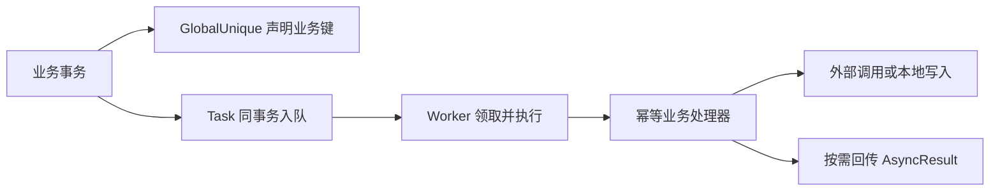

<!-- Generated by doc-sync-agent.py; sources: loadup-components/reliability/README.md, loadup-components/reliability/ARCHITECTURE.md -->

消费应用导入 [Framework BOM](../../dependencies/)，再按需求选择下表中的工件。此目录的聚合 POM 用于组织 Maven 子模块。

| 组件 | 适用场景 | 接入要点 |
| --- | --- | --- |
| [持久化任务](../task/) | 事务内提交任务、租约领取和故障恢复 | 使用宿主数据源，应用队列迁移并注册 Task Handler。 |
| [异步结果](../async-result/) | 关联等待方与完成方 | 根据进程范围选择 Local 或 Redis 实现。 |
| [分布式锁](../lock/) | 对共享资源进行互斥 | 配置后端与命名空间，明确锁持有时间。 |
| [幂等声明](../globalunique/) | 对业务键进行事务内去重 | 部署唯一键表，在业务事务内调用 claim。 |
| [调用容错](../resilience4j/) | 熔断、限流和其他调用保护 | 按调用的失败语义配置容错策略。 |

[分类架构](./#architecture) · [全部组件](../)

---

## 设计与实现

### 职责与依赖

幂等声明依靠数据库唯一约束，互斥依靠锁后端，异步结果通过关联键传递。Task 在业务事务中持久化任务，Worker 在提交后领取。调用是否可重试以及外部副作用如何去重由业务处理器决定。

宿主直接依赖所需的组件工件。目录对应 Maven reactor 的聚合层，运行时依赖由各组件 POM 声明。

### 组件设计

- [持久化任务](../task/#architecture)
- [异步结果](../async-result/#architecture)
- [分布式锁](../lock/#architecture)
- [幂等声明](../globalunique/#architecture)
- [调用容错](../resilience4j/#architecture)

[接入说明](./)
