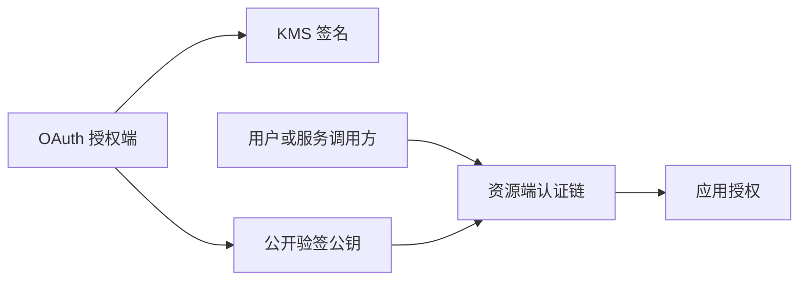

<!-- Generated by doc-sync-agent.py; sources: loadup-components/security/README.md, loadup-components/security/ARCHITECTURE.md -->

消费应用导入 [Framework BOM](../../dependencies/)，再按需求选择下表中的工件。此目录的聚合 POM 用于组织 Maven 子模块。

| 组件 | 适用场景 | 接入要点 |
| --- | --- | --- |
| [OAuth2 与 JWT](../oauth-server/) | 签发、资源端验证、可选 JDBC 持久化 | 按服务角色启用签发、协议端点或资源端校验。 |
| [方法授权](../authorization/) | 业务方法权限判断 | 启用应用的认证链，再配置授权规则。 |
| [服务身份](../service-auth/) | 内部调用的服务令牌与身份校验 | 为每个应用配置对应的客户端身份与 scope。 |
| [密钥与机密管理](../kms/) | 密钥操作、别名以及后端支持的机密操作 | 选择 binder，并在宿主配置后端与密钥。 |
| [报文签名](../signature/) | 对接方报文签名和验签 | 按双方约定配置算法、签名字段和时间窗。 |
| [验证码](../captcha/) | 验证码生成与校验 | 选择 NanoCaptcha 或 Tianai binder。 |

[分类架构](./#architecture) · [全部组件](../)

---

## 设计与实现

### 职责与依赖

OAuth Server 用 KMS 管理签名密钥，资源端按 issuer、受众、用途和时效校验 JWT。应用认证链向方法授权提供可信身份。服务身份和报文签名各有独立的协议边界，验证码由对应的应用入口使用。

宿主直接依赖所需的组件工件。目录对应 Maven reactor 的聚合层，运行时依赖由各组件 POM 声明。

### 组件设计

- [OAuth2 与 JWT](../oauth-server/#architecture)
- [方法授权](../authorization/#architecture)
- [服务身份](../service-auth/#architecture)
- [密钥与机密管理](../kms/#architecture)
- [报文签名](../signature/#architecture)
- [验证码](../captcha/#architecture)

[接入说明](./)
