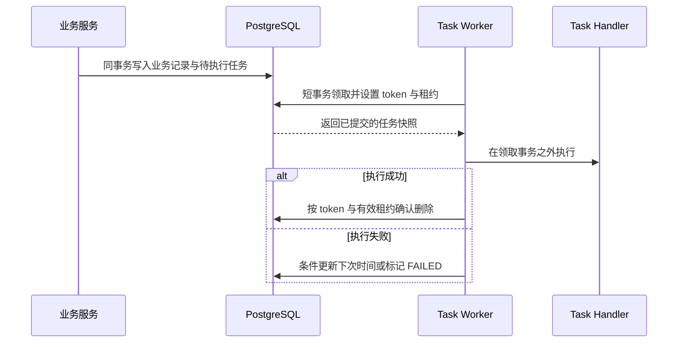

<!-- Generated by doc-sync-agent.py; sources: loadup-components/reliability/loadup-components-task/README.md, loadup-components/reliability/loadup-components-task/ARCHITECTURE.md -->

单一持久化任务模块。事务内提交工作，提交后立即或按计划执行；消息投递、业务截止时间和恢复轮询共享一张队列表与一套执行引擎。

## 接入

引入 `io.github.loadup-cloud:loadup-components-task`，将所选数据库的 `db/task/pg/schema.sql` 或 `db/task/mysql/schema.sql` 纳入应用的初始迁移。业务写入与任务提交必须使用同一 DataSource、同一 Spring JDBC 事务管理器。

```java
@Transactional
public void accept() {
    orders.save(order);
    tasks.submit(TaskSubmission.immediate("order.notify", deliveryId, frozenPayload));
    tasks.submit(TaskSubmission.scheduled("order.expire", order.id(), order.dueAt()));
}
```

`TaskSubmission` 的完整字段是 taskType、bizId、payload、executeAt。executeAt 为空表示尽快执行。payload 可以为空，最大 1 MiB，不应包含凭证。业务需要版本时由业务载荷或任务类型表达。队列统一按 `(taskType, bizId)` 去重。bizId 标识本次工作。多代任务可使用业务 ID 加代数，事件投递可使用投递 ID。同一业务的不同工作应使用不同的 bizId。

```java
@Component
public class ExpireHandler implements TaskHandler {
    public String taskType() { return "order.expire"; }
    public void handle(TaskExecution task) {
        orders.closeIfUnpaidAndExpired(task.bizId());
    }
}
```

Handler 在领取事务提交后执行；自行调用业务事务并检查业务状态，外部调用设置超时。正常返回表示成功，异常触发技术重试。业务仍未完成时登记下一代任务，不把下一轮业务轮询视为本次技术失败。

## 配置

```yaml
loadup:
  task:
    enabled: true
    db-type: pg
    table-prefix: loadup_
    worker-enabled: true
    trigger: local
    poll-interval: PT1M
    batch-size: 10
    max-attempts: 8
    lease: PT2M
    retry-delay: PT5S
    types:
      "[order.expire]":
        max-attempts: 5
        lease: PT5M
        retry-delay: PT1M
        exponential: false
```

`db-type` 选择 `pg` 或 `mysql`，默认 `pg`。MySQL 使用 8.0.17 及以上版本和 InnoDB。运行 SQL 按方言从 `db/task/<db-type>/queries.sql` 加载。配置只选择 SQL，数据库连接仍由应用提供。

`table-prefix` 默认是 `loadup_`，应用于 `task` 和 `task_operation`。前缀可留空，非空时以小写字母开头，只含小写字母、数字和下划线，最多 49 个字符。初始化脚本使用默认前缀。自定义时，先在应用的迁移中替换表及索引的 `loadup_` 前缀，再将同一值配置到 `loadup.task.table-prefix`。已有表的前缀变更由应用迁移处理。

`trigger` 选择扫描入口。默认 `local`，上一批结束后按 `poll-interval` 等待，默认 1 分钟。`scheduler` 关闭本地轮询，由 Scheduler 唤醒同一个 Dispatcher。每次最多处理 `batch-size` 条（默认 10），逐条领取后立即执行。

使用 Scheduler 时，应用需引入一个 Scheduler binder（Local 或 PowerJob）。例如：

```yaml
loadup:
  task:
    trigger: scheduler
  scheduler:
    binder-type: local
```

Task 自动注册 `loadup-task-scan`，每分钟触发一次，可通过 `loadup.scheduler.tasks` 中同名条目的 `cron` 覆盖。Scheduler 模式忽略 `poll-interval`。同一部署的副本使用同一种触发方式；同一个 PowerJob App 的执行副本应使用相同的任务清单和 Handler 范围。

实例只领取本地已注册 Handler 的任务类型。`loadup.task.task-type` 可进一步缩小范围；没有可执行 Handler 时不启动扫描。`worker-enabled: false` 关闭自动扫描，仍可登记和管理任务，也可手工调用 `TaskDispatcher.execute()`。所有后台访问使用应用固定 schema，不恢复请求身份。

## 管理

submit 返回任务 ID；find(id) 查询完整任务，find(type,bizId) 返回最新登记项，仅供业务定位。cancel(id) 支持 PENDING/RUNNING/FAILED；reschedule(id,time) 支持 PENDING/FAILED/CANCELLED；retryFailed(id,operator,reason) 只接受 FAILED，保留任务 ID、payload 和原计划时间并记录人工操作。

`types` 可省略或配置为空。默认最多尝试 8 次（含首次执行），租约 2 分钟，重试从 5 秒开始按指数退避，最长 24 小时。按类型可覆盖 `max-attempts`、`lease`、`retry-delay`、`exponential`，部分覆盖继承全局默认值。`exponential: false` 使用固定间隔。

提交时把初始计划写入 `next_execute_at`，同时保存 `max_attempts`。领取时按当前类型配置计算 `lease_until`。失败且还有次数时，按当前类型配置更新 `next_execute_at`；次数耗尽时进入 FAILED。状态变更更新 `updated_at`，成功确认直接删除任务行。租约与退避以数据库时钟为准。业务截止时间由业务记录保存。应用与数据库会话应使用一致的时区。

## 能力矩阵

| 能力 | 契约 |
|---|---|
| 事务一致性 | 登记强制加入同数据源的可写业务事务 |
| 去重 | 同一任务类型与业务 ID 返回同一任务 ID，载荷不同则冲突。重复提交保留当前执行时间，需要改期时调用 reschedule |
| 立即/定时执行 | 同一提交接口；到期后领取，不保证精确触发时刻 |
| 多实例与崩溃恢复 | SKIP LOCKED + claim token + 有效租约确认 |
| 失败恢复 | 有限指数退避、人工重试审计、取消与改期 |
| 完成清理 | 有效领取者成功确认后直接删除任务行 |
| 执行保证 | 至少一次，无顺序或恰好一次保证 |
| 续租、归档 | 尚未提供；Handler 必须幂等，租约覆盖正常处理时间 |

查询结果包含任务 payload，应用负责授权和响应裁剪；日志及 toString 隐藏 payload。组件不提供管理 Controller。成功确认后直接删除任务，查询不再返回该行，提交去重键也随之释放。需要长效幂等的业务通过自己的唯一约束或已提交结果识别重复处理。处理成功至确认删除之间如果发生崩溃，任务仍可能重新执行。失败、取消的任务保留，供人工重试或改期；人工重试日志仍保留。

本次重构未运行构建、测试或部署验收。

---

<a id="architecture"></a>
## 设计与实现

单一 jar、单一 TaskTemplate/TaskHandler 接口、单一任务主表。消息载荷与执行时间是任务属性，不设旧组件模式或双状态机。

### 提交、执行与确认



业务事务：业务写入 + submit，同步提交或回滚。
领取事务：仅在本实例可处理的类型中恢复已耗尽尝试次数的过期租约，再用 SKIP LOCKED 领取一条记录，生成新 token、递增 attempts、设置租约，提交。
事务外：调用 Handler。
确认事务：按 id、RUNNING、token 和有效租约条件删除或延后。

TaskDispatcher 挂起调用方事务；领取、确认与人工操作使用独立短事务。数据库时间决定就绪、租约与重试，避免节点时钟差。逐条领取执行，不预领整批。任务行只保留下次执行时间与提交时的尝试上限。领取和失败时读取类型配置，分别计算租约截止时间和重试时间。业务截止时间仍由业务表维护。

PENDING → RUNNING → 成功确认后删除；异常返回 PENDING 或耗尽进入 FAILED。过期 RUNNING 可重领或进入 FAILED。取消清空 token；改期和人工重试清零 attempts。旧执行者不能回写新状态，但可能仍产生外部副作用，业务幂等依然必要。

数据库对 `(task_type, biz_id)` 建立唯一约束。同一业务下的独立投递或下一代任务使用不同 bizId。任务 payload、type 和业务 ID 在登记后保持不变。重复提交不会重置队列时间，主动改期通过 reschedule。去重只覆盖仍在队列表中的记录。成功删除后，由业务结果或唯一约束提供长效幂等。

完成后查询从业务状态读取结果。应用可以从已提交的业务结果推导完成，任务尝试次数随队列行一起删除。

本地 TaskWorker 是默认触发入口，按固定延迟扫描。选择 Scheduler 后，本地 Worker 停止，由已有 binder 按 Cron 唤醒同一个 Dispatcher。两个入口默认每分钟扫描，每批最多 10 条，逐条领取并串行处理。Dispatcher 根据本地 Handler 生成类型白名单，task-type 只能缩小范围；白名单为空不扫描。慢任务和关键投递可分别部署执行节点。

Scheduler 只负责触发；提交、领取和确认的接口不依赖 Scheduler binder、PowerJob、ORM 或消息中间件。同一 JDBC 实现根据配置加载 PostgreSQL 或 MySQL 语句。表前缀通过白名单校验，其余数据均通过 JDBC 参数绑定。测试源码与静态审阅不代表实际数据库故障恢复验收。
