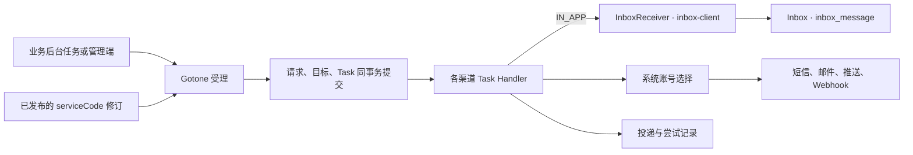

<!-- Generated by doc-sync-agent.py; sources: loadup-modules/loadup-modules-gotone/README.md, loadup-modules/loadup-modules-gotone/ARCHITECTURE.md -->

Gotone 按 `serviceCode` 展开 SMS、Email、Push、站内信和 Webhook。一个编码可同时启用多个渠道。SMS 和 Email 自动选择账号，Push 按设备令牌归属投递，Webhook 按服务编码展开已选端点。

| Maven 坐标后缀                 | 用途                                                          |
|--------------------------------|---------------------------------------------------------------|
| `loadup-modules-gotone-client` | 业务调用方依赖。提供 `GotoneFacade`、投递查询和配置管理契约。 |
| `loadup-modules-gotone-core`   | 配置、模板、持久化受理、Task、渠道适配器和数据库迁移。        |
| `loadup-modules-gotone-web`    | HTTP 接入，传递依赖 core 和 client。                          |

坐标由 `loadup-modules-bom` 管理，groupId 为 `io.github.loadup-cloud`。现有宿主使用 PostgreSQL。Gotone 的建表 DDL 已在
MySQL 8.0 和 H2 2.4 验证可创建 11 张表，但其他引擎的完整接入尚未验证。宿主须提供 Framework Task 和序列分配表。Flyway
只建表和索引，不导入账号、服务编码或模板；新部署需由管理员配置发送账号并发布服务编码。Boot 和 Pay NotificationCenter 同时装配
Gotone 与 Inbox，并启用两个模块的 Flyway 位置。持久化细节见[架构设计](./#architecture)。

## 配置与投递

超级管理员在「通知管理 → 服务编码」选择渠道、声明参数并填写各渠道模板。表达式 `${orderNo}`
引用同名参数。草稿只对创建人可见，发布后整版生效。历史模板可以恢复并发布成新版本。邮件 HTML 中的变量只用于文字内容，Webhook
JSON 变量放在字符串值中。Inbox 跳转地址须为站内路径。

「系统发送配置」维护独立的供应商账号、优先级、连接超时、凭证引用和短信备案映射。账号运行时从 `kms:<名称>` 或
`env:GOTONE_SECRET_<名称>` 读取秘密。

| 渠道 | 适配器与配置 |
|---|---|
| SMS | `aliyun` 与 `twilio` 沿用原有配置。`tencent` 配置 `secretId`、`sdkAppId`、`region` 和 SecretKey 凭证引用，再按服务编码版本登记备案模板。模板变量按 `1`、`2` 等连续编号映射到业务参数。中国大陆短信需要备案签名，可用账号的 `signature` 或模板映射的签名。 |
| Email | `smtp` 使用宿主的 `spring-boot-starter-mail`，每个账号独立配置主机、端口、用户名、发件地址和 STARTTLS 或 SMTPS。 |
| Push | `fcm` 配置 `projectId` 和服务账号 JSON。`jpush` 配置 `appKey` 和 Master Secret，可选 `apnsProduction`（默认 `true`），支持 Android 和 iOS。`xiaomi` 使用中国大陆 Android RegID，配置 `packageName`、App Secret 和可选 `channelId`。`huawei` 使用华为 Push Kit Android 通知接口，配置 `clientId` 和 Client Secret。四种适配器均需填写应用标识 `appId` 和设备 `platform`。 |
| Inbox | 使用 Inbox 模块在本地入箱。提交时提供收件人用户 ID。 |
| Webhook | `dingtalk`、`wecom`、`feishu` 使用群机器人文本消息。通过 `settings.destinationRef` 引用完整机器人 URL，钉钉和飞书可通过 `secretRef` 引用加签密钥。通用 `https` 适配器发送 JSON 正文，URL 的域名须在宿主的 `loadup.modules.gotone.webhook.allowed-hosts` 中，带令牌的 URL 使用凭证引用。 |

SMS 和 Email 对同一收件人按账号顺序尝试，任一账号受理即停止。明确拒绝后可以尝试下一个账号，超时且无法判定是否受理时记为待核对。

Webhook 在一个服务编码里最多选择 20 个端点，每个端点产生一笔投递。通过 API 发布路由时，`fields.endpointCodes`
填写逗号分隔的端点编码，例如 `dingtalk-ops,wecom-ops,feishu-ops`。机器人端点配置 `text`，通用 HTTPS 端点配置
`payload`，混用时分别填写。已有的单端点 `endpointCode` 可继续读取。

Push 提交每个账号实际签发的设备令牌。同一请求可为一个设备提供多个供应商的令牌，每笔投递并行调度并独立记录结果。
只有一个已启用账号匹配平台和应用时，可以省略 `accountCode`。管理端发布页可逐组选择账号及填写设备令牌。

可通过 core 注册额外的 `GotoneProvider`。[腾讯云短信](https://cloud.tencent.com/document/api/382/55981) ·
[极光推送](https://docs.jiguang.cn/jpush/server/push/rest_api_v3_push) ·
[小米推送](https://dev.mi.com/xiaomihyperos/documentation/detail?pId=1559) ·
[华为 Push Kit](https://developer.huawei.com/consumer/cn/doc/HMScore-Guides/android-server-dev-0000001050040110/) ·
[钉钉](https://open.dingtalk.com/document/robots/customize-robot-security-settings) ·
[企业微信](https://developer.work.weixin.qq.com/document/path/91770) ·
[飞书](https://open.feishu.cn/document/ukTMukTMukTM/ucTM5YjL3ETO24yNxkjN)

## 调用

跨模块从业务提交后的后台任务调用 `GotoneFacade.submit(source, senderId, command)`。服务间使用
`POST /api/internal/v1/gotone/submit`，要求 SERVICE JWT 及 `gotone:submit` scope。使用
`GET /api/internal/v1/gotone/requests/{id}` 查询本来源的投递，要求 `gotone:status` scope。

```json
{
  "serviceCode": "servicecodeA",
  "requestKey": "order-paid-7391",
  "parameters": { "orderNo": "7391" },
  "recipientsByChannel": {
    "SMS": [{ "address": "+8613800000000" }],
    "EMAIL": [{ "address": "buyer@example.org" }],
    "PUSH": [
      { "address": "jpush-registration-id", "platform": "ANDROID", "appId": "buyer-app", "accountCode": "buyer-jpush" },
      { "address": "xiaomi-registration-id", "platform": "ANDROID", "appId": "buyer-app", "accountCode": "buyer-xiaomi" }
    ],
    "IN_APP": [{ "address": "user-42" }]
  }
}
```

响应返回 `requestId`、配置版本、受理时间和目标数。相同来源与请求键重试时返回原受理结果，内容冲突会被拒绝。Webhook
目标由发布版本提供。管理端可以发布、查看各目标的尝试、登记供应商核对结果，或对已确认失败且仍在有效期内的目标登记重试。

宿主启用 Gotone 时需提供 Inbox 接收实现。Gotone 将 `deliveryId` 传给 `InboxReceiver` 作为幂等键，入箱与标记 `SENT`
共用一个本地事务。收件箱页面调用 `/api/inbox`。Gotone 模块与 HTTP 开关分别为 `loadup.modules.gotone.enabled` 和
`loadup.modules.gotone.web.enabled`。 [Inbox 接入说明](../inbox/)

更多表结构、任务状态和验收场景见 [架构设计](https://github.com/loadup-cloud/loadup-modules/blob/main/loadup-modules-gotone/DESIGN.md)。

## 子模块入口

- 客户端契约的[接入](../gotone-client/)与[设计](../gotone-client/#architecture)。
- 业务实现的[接入](../gotone-core/)与[设计](../gotone-core/#architecture)。
- Web 适配的[接入](../gotone-web/)与[设计](../gotone-web/#architecture)。

---

<a id="architecture"></a>
## 设计与实现



`web` 适配 HTTP 和身份鉴权，`client` 定义调用契约，`core` 实现应用逻辑、渠道集成及 MyBatis-Flex Mapper。一个渠道的一个目标对应一条
Task。Inbox 写入和结果在同一事务，外部尝试在调用前登记，数据库事务之外执行传输。Task 类型分别为 `gotone.deliver.sms`、
`gotone.deliver.email`、`gotone.deliver.push`、`gotone.deliver.inbox`、`gotone.deliver.webhook`。可通过 `loadup.task.types`
覆盖每类租约及重试策略，或用 `loadup.task.task-type` 部署专用 Worker。

Framework Task 按任务类型注册五个适配器。`SmsDeliveryHandler`、`EmailDeliveryHandler`、`PushDeliveryHandler` 和
`WebhookDeliveryHandler` 复用外部投递流程，包括供应商调用、限流、超时、重试和尝试记录。Push 和 Webhook 各自处理账号匹配，Webhook
也负责解析目的地凭证。`InboxDeliveryHandler` 负责本地事务投递。外部供应商实现在
`app.integration.sms`、`app.integration.email`、`app.integration.push` 和 `app.integration.webhook` 下。

Push 按设备令牌及其账号拆成独立 Task，Webhook 按已发布的端点拆成独立 Task。Framework Task Dispatcher 每批最多同时处理
四笔投递，Push 和 Webhook Handler 可以并行执行。单笔失败、超时或重试只影响对应目标。SMS 和 Email 每个收件人使用一条 Task，
确认未受理后可以顺序尝试其他账号，任一账号受理即停止。

发布配置固定修订和渠道模板，受理时保存每个目标的渲染快照。账号凭证和启用状态按执行时解析。确认未受理的暂时失败可重试。Push 和 Webhook 限定在原目标账号，SMS 和 Email 可以重新选择账号。响应不明时记录
`UNKNOWN`。管理员可登记核对结果，只有确认失败且仍在有效期内的投递可以重试。工作者的尝试序号保护结果更新。请求查询时对账 Task
已耗尽的记录。状态明细只展示脱敏目标、失败码与供应商回执。

Gotone 保管站内信模板和投递记录。`IN_APP` Handler 以 `deliveryId` 作为幂等键调用 `inbox-client` 的 `InboxReceiver`，在同一
JDBC 事务标记 `SENT`。收件人消息副本及已读、归档状态归 Inbox 模块。 [Inbox 模块](../inbox/)

Gotone 使用 11 张 `gotone_` 表。渠道模板和账号设置存为文本 JSON，由应用校验，不按渠道复制表。持久化对象继承 `BaseDO`，字符串
ID 由 `IdGenerator` 生成；MyBatis-Flex Mapper 由 Database processor 生成，常规单表操作使用生成 Mapper。

DDL 不包含外键，仓储不使用多表 JOIN 或 PostgreSQL 专属运行时 SQL。表间引用由应用校验、唯一约束和本地事务维护。
`(source, request_key)` 唯一键竞争失败后，受理方重新读取已提交行并比较内容摘要，匹配则返回既有受理结果，否则报告冲突。生成的
Mapper 与 Framework Task 共享 Spring 管理的连接与事务。

建表 DDL 已在 MySQL 8.0 和 H2 2.4 验证可创建全部 11 张表；现有宿主使用 PostgreSQL，其他引擎的完整接入尚未验证。Gotone
需要宿主提供 Framework Task。Flyway 只建表和索引，不含服务、账号或模板种子数据；新部署由管理员创建账号并发布服务编码。审批提醒需预先发布
`approval.pending` IN_APP 配置，示例见[详细设计](https://github.com/loadup-cloud/loadup-modules/blob/main/loadup-modules-gotone/DESIGN.md)。

[接入方式](./) · [详细设计](https://github.com/loadup-cloud/loadup-modules/blob/main/loadup-modules-gotone/DESIGN.md)
