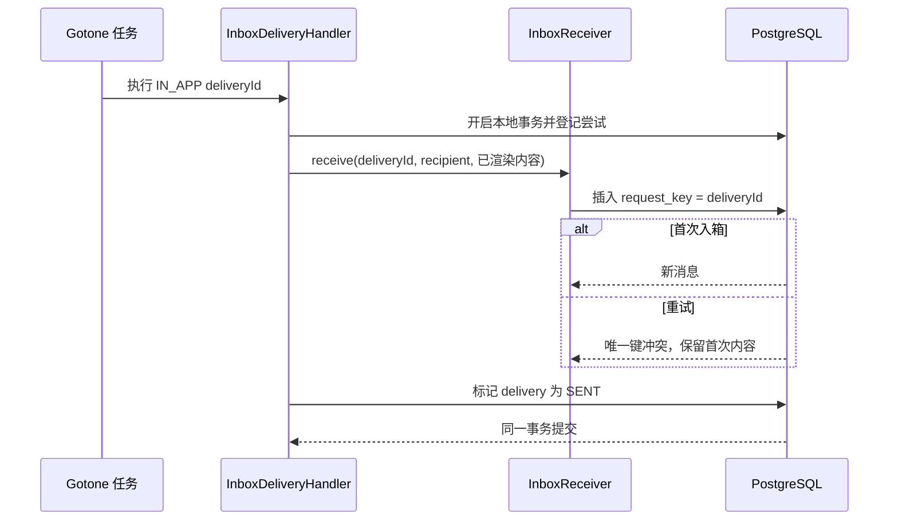
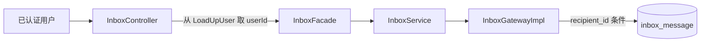

<!-- Generated by doc-sync-agent.py; sources: loadup-modules/loadup-modules-inbox/README.md, loadup-modules/loadup-modules-inbox/ARCHITECTURE.md -->

Inbox 保存当前用户收到的站内信，提供分页查询、未读计数、标记已读和归档。实际收到的标题、正文和跳转地址在入箱时固定。

| Maven 坐标                    | 职责                                                                                |
|-------------------------------|-------------------------------------------------------------------------------------|
| `loadup-modules-inbox-client` | `InboxReceiver` 幂等接收已渲染消息，`InboxFacade` 管理收件人的查询和状态。          |
| `loadup-modules-inbox-core`   | 通过 Database 组件持久化。MyBatis-Flex 根据 `InboxMessageDO` 生成 Mapper 和表定义。 |
| `loadup-modules-inbox-web`    | 通过 `/api/inbox` 处理收件人请求。收件人 ID 取自登录身份。                          |

三个 JAR 由 `loadup-modules-bom` 管理，groupId 为 `io.github.loadup-cloud`。宿主接入 `inbox-web` 并将
`classpath:db/migration/modules/inbox` 加入 Flyway，在新 schema 中初始化 `inbox_message`，同时提供 Database
组件所需的序列分配表。Inbox 模块开关为 `loadup.modules.inbox.enabled`，Web 开关为 `loadup.modules.inbox.web.enabled`。

Gotone 的 `IN_APP` 任务传入收件人 ID、渲染内容和稳定的 `deliveryId`。Inbox 以 `(recipient_id, request_key)`
去重，重复调用保留首次入箱内容。宿主将两个模块装配在同一个应用中，使用同一个 PostgreSQL DataSource 和 JDBC 事务管理器。入箱和标记
`SENT` 一起提交或回滚。

| 用户操作     | POST 路径                 |
|--------------|---------------------------|
| 查询消息     | `/api/inbox/list`         |
| 查询未读数   | `/api/inbox/unread-count` |
| 标记一条已读 | `/api/inbox/read`         |
| 标记全部已读 | `/api/inbox/read-all`     |
| 归档一条消息 | `/api/inbox/archive`      |

[Gotone 投递说明](../gotone/)

## 子模块入口

- 客户端契约的[接入](../inbox-client/)与[设计](../inbox-client/#architecture)。
- 业务实现的[接入](../inbox-core/)与[设计](../inbox-core/#architecture)。
- Web 适配的[接入](../inbox-web/)与[设计](../inbox-web/#architecture)。

---

## 设计与实现

Inbox
保存按收件人隔离的已渲染消息。消息写入后，标题、正文和站内跳转路径固定；用户可分页查看、读取未读数、标记已读和归档。模块整体边界见[README](./)。

### 分层与存储

| 层             | 责任                                                                                                                   |
|----------------|------------------------------------------------------------------------------------------------------------------------|
| `inbox-client` | `InboxReceiver` 接收已渲染通知；`InboxFacade` 提供收件人查询和状态操作。                                               |
| `inbox-core`   | `InboxReceiverService`、`InboxService` 校验输入并执行用例；`InboxGatewayImpl` 通过 MyBatis-Flex 读写 `inbox_message`。 |
| `inbox-web`    | 从登录主体取得收件人 ID，映射查询和状态 API。                                                                          |

Flyway 脚本 `db/migration/modules/inbox/V20261126000001__create_inbox.sql` 建立消息表，并以 `(recipient_id, request_key)`
唯一约束保证同一收件人的重复投递不会新增消息。Core 持久化自动配置要求单一 DataSource 且 `loadup.modules.inbox.enabled`
未关闭；Web 自动配置要求 `InboxFacade` 可用且 `loadup.modules.inbox.web.enabled` 未关闭。

### 通知投递与重放

Gotone 的 `InboxDeliveryHandler` 在一个 `TransactionTemplate` 内写 Inbox 并将 delivery 标记为 `SENT`。
`InboxReceiverService` 校验内容和站内路径后调用 Gateway；Gateway 用嵌套事务保存点处理唯一键冲突，使重复调用可安全完成外层任务。宿主应把
Inbox 和 Gotone 装配在同一应用，使用同一 PostgreSQL DataSource 和 JDBC 事务管理器。

### 收件人读取和状态更新

控制器不接受请求体提供的收件人身份。列表、未读计数、已读和归档操作都使用登录用户 ID；Gateway 的读写查询再以 `recipient_id`
限定所有权。归档消息从正常列表隐藏，历史记录仍保留。

Controller 基路径为 `/inbox`，包含 `POST /list`、`/unread-count`、`/read`、`/read-all` 和 `/archive`；LoadUp WebMVC 默认外部路径含
`/api`。更多模块接入与接口摘要见[README](./)。
