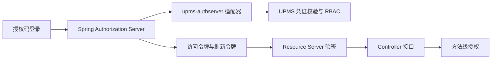

<!-- Generated by doc-sync-agent.py; sources: loadup-modules/loadup-modules-upms/README.md, loadup-modules/loadup-modules-upms/ARCHITECTURE.md -->

用户、角色、权限和部门业务模块。UPMS 校验凭证，提供角色继承的 RBAC 授权及基于资源所属人、部门的数据范围判定；令牌签发由
AuthServer 完成。

账号安全自助接口由 `loadup-modules-upms-web` 提供：`GET /api/account/security/overview` 查看本人状态，
`GET /api/account/security/logins` 查看本人登录记录，`POST /api/account/security/password` 使用旧密码修改本人密码。用户 ID
从认证主体取得，不接受请求指定其他账号。新密码必须符合当前强度规则并与旧密码不同。管理员的锁定与解锁接口仍在
`/api/upms/user/**`。

登录失败达到配置阈值后临时锁定；到期后的下一次登录会自动解锁。管理员手动锁定不会自动解锁。HTTP 登录记录使用服务端观察到的
IP，不信任客户端传入的转发头。当前 JWT 为无状态令牌，修改密码或锁定账号不会立即撤销已签发令牌；已有令牌可用至其到期，后续撤销机制见
Roadmap。

## 引入

```xml
<dependency>
  <groupId>io.github.loadup-cloud</groupId>
  <artifactId>loadup-modules-upms-app</artifactId>
</dependency>
<!-- Default persistence is an explicit consumer choice. -->
<dependency>
  <groupId>io.github.loadup-cloud</groupId>
  <artifactId>loadup-modules-upms-infrastructure</artifactId>
</dependency>
```

前后端分离的用户名密码登录需引入 `loadup-modules-upms-authserver` 与 `loadup-components-oauth-server-core`，通过
`POST /api/auth/login` 获取 JWT。可设置 `loadup.security.auth-server.protocol-endpoints-enabled: false` 关闭 OAuth2 协议端点。

## 配置

```yaml
loadup:
  modules:
    upms:
      security:
        login:
          enable-failure-tracking: true
          max-fail-attempts: 5
          lock-duration: 30
```

`AuthenticationService.login` 是内部身份校验接口；HTTP 登录由 authserver 适配器完成。需要预置用户注册与 RBAC HTTP 接口时，再引入
`loadup-modules-upms-web`；也可以直接在应用 Controller 中调用 UPMS 服务。

业务代码注入 `AccessCheckService`，调用
`check(new AccessCheckCommand(userId, permissionCode, ownerUserId, departmentId))`
。结果默认拒绝；仅当有效角色授予该权限，且该角色的数据范围匹配资源属性时放行。`@PreAuthorize` 可校验静态权限，资源级 ABAC
判定须显式调用此 API。

| 能力                    | 所属模块                                        |
|-------------------------|-------------------------------------------------|
| 用户凭证校验与登录策略  | `loadup-modules-upms-app`                       |
| 角色与权限数据          | `loadup-modules-upms-domain`、`-infrastructure` |
| RBAC + 资源属性判定 API | `loadup-modules-upms-client`、`-app`            |
| 可选 HTTP Controller    | `loadup-modules-upms-web`                       |
| SAS 用户认证适配        | `loadup-modules-upms-authserver`                |
| 令牌签发与刷新          | `loadup-components-oauth-server-core`           |
| Bearer 验签             | `loadup-components-oauth-server-core`           |
| 方法级授权              | `loadup-components-authorization`               |

## 敏感数据展示与明文读取

普通 `UserDetailDTO` 的姓名、邮箱、手机号在 WebMVC JSON 输出中固定脱敏；内部对象与数据库保留原值。管理员也遵循同一展示规则。用户修改时省略敏感字段表示不变，显式空字符串表示清空；包含
`*` 的姓名、邮箱或手机号不能写入，避免把掩码保存为原数据。管理端编辑界面将这些字段留空，填写新值才更新。

`POST /api/upms/user/sensitive` 是独立明文读取入口，要求 JWT 静态 authority `upms:user:sensitive:read`
，并重新执行有效角色权限与目标用户数据范围的 RBAC/ABAC 校验。请求示例：

```json
{"id":"target-user-id","purpose":"CUSTOMER_SUPPORT"}
```

purpose 只允许 `PROFILE_CORRECTION`、`CUSTOMER_SUPPORT`、`SECURITY_REVIEW`。接口没有超级管理员绕过规则；需要显式配置权限及相应角色数据范围，不自动授予现有账号。返回
`result/data`，data 只含 id、realName、email、mobile；响应为 `Cache-Control: no-store`。

明文返回前必须有 `SensitiveReadAudit` 同步持久化访问记录。消费工程显式引入 `loadup-modules-audit` 后，Web
适配器提供默认桥接，以独立事务记录 actor、目标 ID、用途与 traceId，不记录字段原文。缺失审计组件或写入/提交失败则拒绝明文；也可提供自己的可靠
recorder。

## 业务配置命名空间

模块专属配置统一使用 `loadup.modules.upms.*`，配置中心与消费工程需同步迁移旧前缀；登录策略为
`loadup.modules.upms.security.login`，OAuth 为 `loadup.modules.upms.security.oauth`。认证协议与令牌校验继续使用全局
`loadup.security.*`。

## 密码强度配置

在 ConfigCenter 发布键 `loadup.modules.upms.security.password-strength`，值填写 `normal` 或 `strong`。

| 选项 | 新密码要求 |
| --- | --- |
| `normal`（默认） | 至少 8 个 Unicode 字符，最多 72 个 UTF-8 字节 |
| `strong` | 至少 12 个 Unicode 字符，须包含大写字母、小写字母、十进制数字和标点或符号，同样最多 72 个 UTF-8 字节 |

选择 ConfigCenter binder 由宿主负责。未配置 binder、远端键缺失或删除时，使用同名 Spring 配置，默认 `normal`。已发布的合法值会动态生效，非法远端值记录告警并保留当前规则。创建用户、注册、修改和重置密码均使用当前规则。已有密码继续用于登录。

`GET /api/auth/password-policy` 公开当前规则名、最少字符数、UTF-8 字节上限及所需字符类型。Admin 的修改密码与重置密码表单读取此接口。

邮箱重置使用 `POST /api/auth/password-reset/code` 请求验证码，再调用 `POST /api/auth/password-reset` 提交账号、验证码及新密码。宿主应配置 `PasswordResetEmailSender`，验证码只发给账号已验证的邮箱。验证码在签发实例保存，多实例部署需将请求验证码和提交重置路由到同一实例。

## 角色菜单

登录后以当前账号调用 `POST /api/upms/permission/user-menu`，请求体为 `{}`。返回账号有效角色及继承角色可见的菜单，按层级和排序字段排列。为角色分配二级菜单后，启用且可见的无路径上级分组会自动显示。页面菜单单独授权，分组本身不授予其子菜单。

## 输入与安全约定

验证码不写日志，邮箱和手机号显式脱敏。敏感数据展示和明文读取约束见上文。

分页请求、DTO、HTTP
响应结构及共享时间规则见 [commons-dto 文档](../../commons/loadup-commons-dto/)。用户排序字段限于
`createdAt`、`username`、`nickname`、`id`，角色查询只接受已声明字段白名单。业务与持久化时间使用 Spring 共享的
Clock，默认采用系统本地时区。

## 错误码契约

公开错误枚举位于 `io.github.loadup.modules.upms.client.error.UpmsResultCodeEnum`，错误码以 `UPMS_` 开头。服务/领域/仓储使用
`CommonException(enum)`；系统原因可作为 cause 保留，响应文案仅来自枚举。WebMVC 统一返回 HTTP 200 的
result/data。枚举码按稳定公开契约维护，不用字符串消息覆盖。

## Flyway 迁移目录

正式迁移位于 `db/migration/framework/upms/`，文件名、版本和 SQL 内容保持不变。消费应用在
`loadup.flyway.locations` 中显式加入 `classpath:db/migration/framework/upms`，与应用自己的迁移共同自动执行。
不要用共享根 `classpath:db/migration` 表达应用隔离；它也会扫描依赖 JAR。已执行版本只追加升级，不改写历史。

阶段 1C 已分开 app 与默认持久化装配。仅使用自定义 Gateway 时可只引入 app；Web/AuthServer 已显式包含默认
infrastructure，应用可逐接口替换 Gateway。未改登录策略、身份、权限、token 协议、SQL 或部署配置。源码及回归源码已同步，未构建或测试。

---

<a id="architecture"></a>
## 设计与实现

账号安全自助读写由 `AccountSecurityController → AccountSecurityService → UserGateway/LoginLogGateway` 完成。密码修改复用
`UserService.changePassword` 的旧密码校验、编码与持久化；登录记录通过既有 `LoginLogGateway` 按本人 ID 分页读取。HTTP 层只从已验证
JWT 的 `LoadUpUser.userId` 取当前用户，不从请求读取用户 ID。`UpmsTokenController` 将服务端远端 IP
传入认证服务，成功及已知用户名的失败尝试写入登录日志。临时锁定到期后允许在认证时解锁；管理员手动锁定必须手动解除。

### 边界



UPMS 的 `AuthenticationService.login` 选择登录策略、校验账号凭证并记录登录结果，返回 `AuthenticatedUserDTO`
，不签发令牌。用户、角色、权限、部门数据仍由 UPMS 的 client/domain/infrastructure/app 分层管理。
`loadup-modules-upms-authserver` 是可选适配器：`UpmsAuthenticationProvider` 使用 UPMS 登录接口，随后读取角色和权限；
`UpmsTokenController` 为前端提供 `/api/auth/login` JSON 接口并签发用户 JWT。

`loadup-components-oauth-server-core` 管理签名密钥和 JwtEncoder；启用 OAuth2 协议端点时也管理客户端、授权码和刷新令牌。JWT
的 `sub` 是 UPMS 用户 ID；`roles`、`permissions`、`username`、`aud` 与 `token_use` 在签发时写入。资源端由独立
`loadup-components-oauth-server-core` 校验。关闭协议端点时，资源端直接用本地公钥验签。

### 依赖方向

UPMS 领域对象、对外 DTO 和持久化对象的审计时间统一为 `createdAt`、`updatedAt`；数据库列为 `created_at`、`updated_at`，与框架
`BaseDO` 一致。

- UPMS 核心模块依赖 commons/components，不依赖 SAS 实现；可选 `upms-web` 提供 Controller。
- `loadup-modules-upms-authserver` 当前依赖 UPMS app 与 `loadup-components-oauth-server-core`，包含实际安全协议装配，允许应用按需引入；不是只依赖
  AuthServer API。
- 资源服务器认证和业务授权作用于相应入口/用例；当前 HTTP 调用能力由 Framework 的 HTTP 组件提供，不再描述为尚未存在的未来组件。
- 阶段 1C 已移除 UPMS app 对 infrastructure 的生产依赖；UpmsAutoConfiguration 仅扫描
  app，保留原密码编码及领域权限服务。UpmsPersistenceAutoConfiguration 独立登记六类默认 Gateway，逐接口
  ConditionalOnMissingBean，并用 beforeName 明确先于 app。Web/AuthServer 和 Pay admin 显式选择
  infrastructure；源码及回归源码已同步，未构建或测试。完整依赖及例外见[阶段 0 基线](https://github.com/loadup-cloud/loadup-pay/blob/main/design/PHASE0_BASELINE.md)。
- `GitHubOAuthProvider` 在 app 内通过 Spring `RestClient` 调用 GitHub 的 token 和 userinfo 接口，是已登记的传输适配例外。
- `loadup-components-authorization` 提供 `@PreAuthorize` 方法安全和 `UserContext`，不注册 HTTP 放行链。

### RBAC 与 ABAC

- **client**：`AccessCheckCommand` 和 `AccessDecisionDTO` 是跨模块契约；用户详情只保留 client 的 `UserDetailDTO`
  ，角色/用户查询条件位于 client.query。
- **domain**：`UserPermissionService` 计算有效角色及其继承权限；`AccessDecisionService` 先核对角色授权，再按授予角色的
  `DataScope` 检查资源所属人或部门。继承的权限使用授予该权限的角色的数据范围，循环角色链按已访问 ID 截断。
- **infrastructure**：`upms_user_role`、`upms_role_permission`、`upms_role_department` 是关系存储，通过 Spring JDBC
  访问；仓储实现不承载授权决策。
- **app**：`AccessCheckService` 将 client 请求映射为领域资源属性。登录凭证、登录方式和 OAuth 提供商模型属于应用内部策略，不暴露在
  client。Web 适配不公开可代填任意 userId 的判定端点，调用方须从可信身份上下文获取 userId。

数据范围编码：`1` 全部、`2` 自定义部门、`3` 本部门、`4` 本部门及下级、`5`
仅本人。范围判定所需的所属人或部门属性缺失、未知范围、无有效权限或停用用户均拒绝；“全部”范围无需所属人和部门属性。多个有效角色采用“任一完整授权放行”。该
ABAC 切片只覆盖组织与所属人属性，没有通用表达式策略或环境属性规则；这些能力需具体用例再扩展。

### 运行约束

UPMS 应用密码编码器支持新写入的 `{bcrypt}` 和已有的 BCrypt 哈希。SAS 客户端密钥经 BCrypt 编码。生产环境需配置持久 RSA
私钥；不配置时的临时私钥仅适于本地开发。资源端应使用固定 issuer、audience 和可信 JWK，公开 API 路径由 `permit-all` 明确声明。

当前刷新令牌沿用授权时保存的用户主体，角色和权限是签发时快照；需要撤销后立即生效的部署，应缩短访问令牌有效期，并在上线前实现刷新阶段的
UPMS 重新校验及授权撤销存储。

### 敏感字段与明文访问边界

`upms-client` 输出 `UserDetailDTO` 声明 `@Masked`；domain/DO/Command 不声明展示规则。`upms-app` 的
`UserSensitiveReadService` 校验调用者和请求、读取租户范围内目标、执行 `AccessDecisionService`、调用 `SensitiveReadAudit`
，最后才经 Spring MapStruct `UserSensitiveConverter` 构造不带脱敏注解的 `UserSensitiveDTO`。

`upms-web` 的独立 Controller 从认证主体取得 actor，不接受客户端指定调用者；静态方法授权与 app 中最新角色/资源范围校验同时存在。purpose
为枚举，audit SPI 不接受任何敏感原文。审计模块是 web 的 optional 依赖，app/domain 无 audit 横向依赖；默认桥接仅在
AuditFacade 存在时装配，并以 REQUIRES_NEW 事务确保成功提交后才能返回。当前 web 的 Maven optional 依赖为
audit-core，自动配置还引用其 AuditAutoConfiguration；app/domain 不直接依赖审计模块。缺少 recorder 时普通查询继续可用，明文请求失败。

普通输出不因角色权限变成明文；明文 DTO 的 toString 只输出 ID，且响应不可缓存。调用方仍须避免记录 HTTP body、DTO JSON
或敏感字段异常。首版未提供通用明文导出，导出处理器须显式执行展示脱敏。

### 公共边界与映射约束

Facade 是 client 的业务契约，应用服务直接实现；Controller 和跨模块消费者依赖 Facade。domain 保留业务状态、规则与
Gateway，表示层字段转换交给 Spring 管理的 MapStruct。共享配置固定 Spring 模式、构造器注入和目标字段严格校验。

仓储依赖 database 的固定 UUID、审计时间、逻辑删除规则，由 database processor 自动生成带 @Mapper 的 XxxDOMapper（继承
BaseMapper），并通过模块生成的 Tables 表达查询。字典删除与文件引用解绑明确使用物理删除；文件状态、通知归档和任务生命周期是业务状态，独立于
BaseDO 的 deleted。

所有数据对象的诊断文本使用 commons-json；诊断序列化与真实 API JSON 分离，避免因 HTTP 脱敏设置改变日志中的凭证披露规则。

### Client 入参与分页边界

client.command 表达业务写动作，client.query 表达只读条件；Controller 和 Facade 共用入参契约。模块专用 PageDTO 已移除，app
将领域分页对象映射为 commons-dto 的 PageDTO；Web 输出 PageResponse，避免分页结构随模块变化。领域 Gateway 的分页返回值不携带
HTTP envelope。

### 输入与安全约定

`PasswordPolicy` 定义各档规则和前端读取的约束数据。`PasswordPolicySettings` 订阅 ConfigCenter 配置并提供当前策略。创建、注册、修改和重置在编码或写入前使用当前策略。`@ValidPassword` 在请求绑定时检查 `normal` 的基础约束。

邮箱重置码绑定账号 ID、已验证邮箱和重置用途，有效期 5 分钟。应用在内存中原子地限制重发和验证次数，并在验证成功后作废该码。写入新密码时重新核对账号状态、已验证邮箱和原密码哈希。邮件由宿主提供的 `PasswordResetEmailSender` 发送。

`PermissionService` 使用有效角色权限生成可见菜单树。它补齐启用且可见的无路径祖先分组，并按排序字段输出同级项。分组不会赋予页面权限。

查询默认 page=1、size=20，最多 100 条；用户排序字段为
createdAt、username、nickname、id，角色按已声明字段白名单排序。验证码不写日志，邮箱和手机号显式脱敏。业务时间和数据库审计字段使用
Spring 共享的 Clock，默认采用系统本地时区。

### 错误码契约

公开错误枚举位于 `io.github.loadup.modules.upms.client.error.UpmsResultCodeEnum`，错误码以 `UPMS_` 开头。服务/领域/仓储使用
`CommonException(enum)`；系统原因可作为 cause 保留，响应文案仅来自枚举。WebMVC 统一返回 HTTP 200 的
result/data。枚举码按稳定公开契约维护，不用字符串消息覆盖。

### 分页契约

纯分页输入使用 `io.github.loadup.commons.dto.PageQuery`。HTTP 字段为 `page` 与 `size`，缺失或为 null 时分别取 1 与 20。显式非法值会被拒绝，每页上限为 100。业务查询保留自身筛选字段及平面分页字段，通过 `PageQuery.normalized` 复用规则并保留所属模块错误码。可变的 UPMS 查询在服务边界通过 `pagination()` 校验。各业务维护自己的排序白名单。

领域 Gateway 返回 `io.github.loadup.commons.domain.PageResult<T>`。应用层通过 Spring 注入的 MapStruct converter 和 `PageResult.map` 转换元素，使用 `PageDTO.of(result)` 保留数量、页码和每页长度。Facade 返回 `PageDTO`，Controller 返回 `PageResponse`。

分页 JSON 形如 `{result, data: [...], pageInfo: {totalCount, pageIndex, pageSize, ...}}`，`data` 为当前页数组。`SuccessResponse` 用于普通成功响应。空 `PageDTO` 使用空数组与 0/1/20 作为元数据默认值。原有业务分页包装、`DictionaryTypePageQuery`、`AccountLoginPageQuery` 或 `SuccessResponse.ofPage` 的 Java 调用方需切换到共享契约。HTTP URL 和载荷字段保持原有契约。
