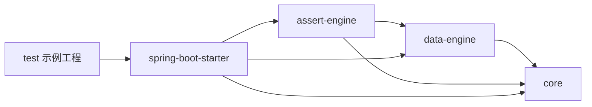

<!-- Generated by doc-sync-agent.py; sources: loadup-testify/README.md, loadup-testify/ARCHITECTURE.md -->

Testify 是用于 JUnit Jupiter / Spring Boot Test 的测试辅助工具，提供案例文件加载、变量展开、数据准备、响应/异常/数据库断言。测试顺序和业务调用由普通 Java 测试控制，适合 Service、Facade 和持久化集成测试。

它不是测试编排平台、HTTP 客户端、Mock 平台或生产组件。所有消费依赖使用 `test` scope。

## 接入路径

| 需求 | 使用方式 | 必需条件 |
|---|---|---|
| 对象、JSON、JsonPath 断言 | `ScenarioAssert.verify / verifyJson` | Testify starter |
| 异常断言 | `ScenarioAssert.verifyException` | 测试代码捕获 Throwable |
| SQL 数据准备/清理 | `TestScenario` | JdbcTemplate 与独立测试数据库 |
| 简单异步数据库断言 | `TestScenario.assertDb` | JdbcTemplate |
| 多行、计数、操作符数据库断言 | `ScenarioAssert.verifyDb` | DbAssertEngine 与 JdbcTemplate |
| 文件批量用例 | `CaseFiles` + `@MethodSource` | 显式解析变量、绑定 input、调用业务 |
| 真实数据库容器 | Testcontainers 组件 | 额外 test 依赖、Docker |
| Mock 外部协作者 | Spring Test / Mockito | 使用其原生 API，Testify 不包装 |

## Maven 接入

消费工程先引入 LoadUp BOM，再添加以下依赖；版本由 BOM 管理。JUnit 版本跟随所选 BOM，注解包仍为 `org.junit.jupiter`。starter 不传递 JUnit 或 Spring Boot Test。

```xml
<dependency>
    <groupId>org.springframework.boot</groupId>
    <artifactId>spring-boot-starter-test</artifactId>
    <scope>test</scope>
</dependency>
<dependency>
    <groupId>io.github.loadup-cloud</groupId>
    <artifactId>loadup-testify-spring-boot-starter</artifactId>
    <scope>test</scope>
</dependency>
```

真实 MySQL 集成测试另外引入 `loadup-components-testcontainers` 和 `com.mysql:mysql-connector-j`，均使用 test scope。数据库初始化由消费工程通过 Flyway 或 Spring SQL init 负责；Testify 不创建业务表。

## 最小响应断言

以下片段可直接放入已有 Spring Boot 测试类；通过构造器注入 `io.github.loadup.testify.starter.scenario.ScenarioAssert`：

```java
private final ScenarioAssert assertions;

@Autowired
MyServiceTest(ScenarioAssert assertions) {
    this.assertions = assertions;
}

@Test
void verifiesResultFields() {
    assertions.verify(
            Map.of("status", "CREATED", "amount", 1200),
            Map.of("status", "CREATED", "amount", Map.of("op", "ge", "val", 1000)));
}
```

没有数据库时仍可使用响应、异常和变量引擎，但 starter 会引入 JDBC 栈。需要排除 Boot 4 的 `org.springframework.boot.jdbc.autoconfigure.DataSourceAutoConfiguration`，或者自行配置测试 DataSource。不要注入此时不存在的 TestScenario；调用 verifyDb 会返回说明缺少数据库断言引擎的 AssertionError。

## 数据库接入与隔离

建议目录：

```text
src/test/java/.../OrderCreateIT.java
src/test/resources/application.yml
src/test/resources/application-test.yml
src/test/resources/application-ci.yml
src/test/resources/testcases/order/create.yaml
```

`application.yml` 激活 test profile；本地与 CI 分别维护容器/数据库配置。基于已有测试启动类使用 `@SpringBootTest(classes = TestApplication.class)`、`@ActiveProfiles("test")` 和 `@EnableTestContainers(ContainerType.MYSQL)`。容器注解来自 `io.github.loadup.components.testcontainers.annotation`。

最小本地配置示例（实际 schema.sql 由消费工程提供）：

```yaml
spring:
  sql:
    init:
      mode: always
      schema-locations: classpath:schema.sql
loadup:
  testcontainers:
    enabled: true
    mysql:
      enabled: true
      image: mysql:8.0
```

Testify 没有独立的 `loadup.testify.*` 开关或超时配置；容器配置属于 Testcontainers 组件，轮询超时由 API/断言数据传入。具体容器配置见 [Testcontainers 接入文档](../components/testcontainers/)。

注入 `TestScenario` 后：

```java
String id = scenario.uuid();
scenario.clean("payment_order", "id", id);
scenario.insert("payment_order", Map.of("id", id, "status", "CREATED"));

scenario.assertDb("payment_order")
        .where("id", id)
        .withTimeout(Duration.ofSeconds(10))
        .exists()
        .has("status", "CREATED");
```

这是数据准备与断言片段，真实业务调用应插入两者之间。若表采用 BaseDO 标准字段，使用 JDBC 准备数据时必须自行提供数据库要求的 tenant_id、created_at、updated_at、deleted 等值；JDBC 不会触发 Flex 监听器。

| API | 语义 |
|---|---|
| `clean(table)` | 物理删除整表记录，仅限独占测试库 |
| `clean(table, column, value)` | 按一个条件物理删除 |
| `insert(table, row)` | 参数化插入；不自动展开变量或补审计字段 |
| `assertDb(table).where(...)` | 可累加相等条件 |
| `exists / notExists` | 等待有记录/没有记录 |
| `has(column, expected)` | 等待首条匹配记录的列值满足相等比较 |
| `withTimeout(Duration)` | 为后续链式断言设置等待上限 |

标识符只接受 `[A-Za-z0-9_]+`；反引号、点号、schema 前缀和 SQL 表达式不受支持。避免保留字表名。默认等待5秒、每100ms轮询；每个链式断言单独等待，整条链不共享一个5秒截止时间。`has` 的多行查询没有指定排序，应使用唯一 ID 条件。

轮询不代表事务提交。异步工作通常看不到测试事务中尚未提交的数据；避免靠测试外层 `@Transactional` 覆盖真实异步场景。使用唯一业务 ID 和限定范围清理；共享容器并行测试不能使用整表 clean。逻辑删除验证应查询 `deleted` 的真实值，clean 始终是物理删除。

## 声明式响应与操作符

```java
assertions.verify(actual, Map.of(
        "$.result.code", "SUCCESS",
        "$.data.id", "${id}",
        "$.data.amount", Map.of("op", "gt", "val", 0)), Map.of("id", id));
```

`SUCCESS` 仅用于协议示例，请使用实际项目的结果码。普通对象期望按字段递归检查，允许实际对象包含额外字段；键以 `$` 开头时走 JsonPath。`verifyJson` 接收原始 JSON 字符串。不同 API 的完整语义和限制见 [断言引擎 README](loadup-testify-assert-engine/)。

| 操作符 | 示例 | 注意事项 |
|---|---|---|
| 普通值 / eq | `status: CREATED` | 默认相等比较 |
| gt / ge / lt / le | `{op: ge, val: 100}` | 数值比较 |
| regex | `{op: regex, val: '^[A-Z]+$'}` | 正则匹配 |
| contains | `{op: contains, val: order}` | 字符串包含 |
| size | `{op: size, val: 2}` | 集合大小 |
| approx | `{op: approx, val: '${now}', threshold: 1000}` | 时间差；threshold 为毫秒，默认3000 |
| json | `{op: json, val: '{"ok":true}', mode: full}` | 默认 lenient；full 使用严格 JSON 比较 |

不要把未知操作符当作能力扩展：当前实现会回退相等比较，并非立即报不支持。顶层操作符 Map、顶层数组、空期望与变量展开存在入口差异；推荐使用对象字段或 JsonPath 下的操作符。

## 数据库与异常声明

```yaml
table: payment_order
mode: lenient
timeout: 5000
interval: 200
rows:
  - _match: {id: '${id}'}
    id: '${id}'
    status: CREATED
```

将上述结构作为 Map、JsonNode 或 JSON 文本传入 `assertions.verifyDb(expected, variables)`。默认 timeout 为0（立即检查），interval 为500ms，单位均为毫秒。它与 TestScenario 的5秒/100ms规则不同。`strict` 会检查获取到的记录数量；不是天然的整张表一致性校验。数据库集合匹配、`_count` 和读取范围详见断言引擎文档。

```java
Throwable failure = assertThrows(CommonException.class, () -> service.execute(command));
assertions.verifyException(failure, Map.of("type", "CommonException"));
```

业务代码和 service.execute 为接入示意。异常引擎检查最深层 cause，因此包装异常未必按外层类型匹配；稳定 ResultCode 建议直接使用 AssertJ/JUnit 断言外层 CommonException。声明式 message 当前主要用于文本相等比较。

## 批量案例文件

`src/test/resources/testcases/echo.yaml`：

```yaml
cases:
  - name: echo supplied identifier
    variables:
      id: '${fn.uuid()}'
    input:
      id: '${id}'
      status: CREATED
    expect:
      id: '${id}'
      status: CREATED
```

下例演示可直接运行的加载/变量/断言流程，`actual` 为输入回显；接入业务时替换回显为 Service 调用：

```java
static Stream<TestifyCase> cases() {
    return CaseFiles.loadYaml("testcases/echo.yaml").stream();
}

@ParameterizedTest(name = "{0}")
@MethodSource("cases")
void executeCase(TestifyCase testCase) {
    Map<String, Object> variables = variableEngine.resolveVariables(testCase.variables());
    Object input = variableEngine.resolveValue(testCase.input(), variables);
    Object actual = input;
    assertions.verify(actual, testCase.expect(), variables);
}
```

对应类型分别来自 `starter.cases`、`data.engine.variable` 和 `starter.scenario`。CaseFiles 只读 classpath 数据，不负责执行、注入、清理或自动解析变量。支持 `cases: [...]`、根数组和单对象；字段别名为 name/id、input/params、expect/expected。对象绑定可用 Testify `JsonUtil.convertValue`，但它使用独立测试 Mapper，不继承 WebMVC 全局 Jackson 配置。

## 变量与扩展

常用表达式：`${fn.uuid()}`、`${fn.random(1,100)}`、`${fn.randomString(8)}`、`${time.now('-2h')}`、`${time.format('uuuuMMdd')}`、`${time.epochMilli()}`、`${faker.name().firstName()}`、`${id}`。random 上界不包含在内；时间默认使用系统本地时区。

必须先调用 resolveVariables，再把结果作为 resolveValue / verify 的 context。跨变量依赖最多尝试10轮；无法解析的占位符可能保持原样或不出现在结果 context，测试代码应主动校验必要变量。案例文件应来自可信测试资源，SpEL 不是不可信输入的沙箱。

自定义函数实现 `TestifyFunction`，然后提供一个替代 `VariableEngine` Bean，显式包含内置 time/fn 与自定义函数。仅声明函数 Bean 不会被默认自动配置收集；完整示例见 [数据引擎 README](loadup-testify-data-engine/)。

## 执行与排错

本仓库的可执行示例见 [测试模块](loadup-testify-test/)。需要运行时使用 Maven Daemon 和 clean，按目的选择：

```shell
# 无数据库的声明式断言/装配回归
mvnd clean test -pl loadup-testify/loadup-testify-test -am \
  -Dtest=ScenarioAssertTest,TestifyAutoConfigurationTest \
  -Dsurefire.failIfNoSpecifiedTests=false

# 真实 MySQL 集成示例，要求 Docker；使用 Surefire 显式选取 IT
mvnd clean test -pl loadup-testify/loadup-testify-test -am \
  -Dtest=UserServiceIT,UserServiceBatchIT \
  -Dsurefire.failIfNoSpecifiedTests=false
```

命令是手动验证入口，不表示本次文档更新已执行测试。不要把源码存在或用例被编译写成运行通过。

| 问题 | 排查方向 |
|---|---|
| 找不到 TestScenario | JdbcTemplate Bean 是否存在，数据源是否成功创建 |
| 无数据库仍报 DataSource 错误 | JDBC starter 的自动配置仍开启，按上述路径排除 |
| SQL 标识符非法 | 去掉反引号/schema/表达式，改用合法表名 |
| strict 行数不符 | 查看 `_match` 读取范围、共享测试数据和 LIMIT 100 回退 |
| 异步断言超时 | 事务是否提交、后台线程租户上下文、条件是否唯一、数据库是否可达 |
| `${...}` 未展开 | 是否先解析 variables，函数是否注册，是否超出依赖轮数 |
| HTTP 报文和对象断言结果不同 | 用真实 HTTP/MockMvc 的序列化结果验证，而不是把测试 Mapper 当成 WebMVC Mapper |

## 子模块文档

- [Core 接入](loadup-testify-core/) / [设计](loadup-testify-core/#architecture)
- [数据引擎接入](loadup-testify-data-engine/) / [设计](loadup-testify-data-engine/#architecture)
- [断言引擎接入](loadup-testify-assert-engine/) / [设计](loadup-testify-assert-engine/#architecture)
- [Starter 接入](loadup-testify-spring-boot-starter/) / [设计](loadup-testify-spring-boot-starter/#architecture)
- [测试示例](loadup-testify-test/) / [设计](loadup-testify-test/#architecture)

---

<a id="architecture"></a>
## 设计与实现

### 定位与职责边界

Testify 是测试依赖，减少测试中的数据准备和断言重复。JUnit 控制测试生命周期，Spring Boot 创建测试上下文，Testcontainers 提供真实环境；Testify 接收测试明确交付的数据和实际结果。不引入 YAML 工作流、方法反射调用、全局 AOP Mock 或生产运行时。

### 模块依赖



箭头表示依赖，聚合 POM 本身没有执行逻辑。Core 的实际职责是测试专用 JsonUtil；data-engine 负责值解析；assert-engine 负责比较和 diff；starter 提供 Spring 装配、案例加载及便捷 JDBC API。Testcontainers 是独立组件，不是 Testify 内置后端。

### 调用路径

```text
JUnit @MethodSource → CaseFiles → TestifyCase
                                ↓
                   VariableEngine.resolveVariables
                                ↓
                   resolveValue(input) → 类型绑定
                                ↓
                   测试代码调用 Service/Facade/HTTP
                                ↓
                   ScenarioAssert → Response/DB/Exception Engine
                                ↓
                   OperatorProcessor → Matcher → DiffReportBuilder
```

数据库准备走另一条显式路径：TestScenario.clean/insert → JdbcTemplate。异步断言是 TestScenario.assertDb → DbAssert，或 verifyDb → DbAssertEngine。两种 API 不共享默认等待策略。

### 自动配置与生命周期

TestifyAutoConfiguration 在 DataSource/JdbcTemplate 自动配置之后执行，要求 JdbcTemplate 类可加载。各 Bean 使用 ConditionalOnMissingBean，消费测试可替换：

| Bean | 前置条件 | 责任 |
|---|---|---|
| VariableEngine | 无额外 Bean 条件 | 默认只注册 TimeFunction / CommonFunction |
| ResponseAssertEngine | VariableEngine | 响应字段与 JsonPath |
| ExceptionAssertEngine | VariableEngine | 根因类型与消息 |
| TestScenario | JdbcTemplate Bean | JDBC 准备/清理与轮询入口 |
| DbAssertEngine | JdbcTemplate Bean、VariableEngine | 多行数据库断言 |
| ScenarioAssert | 两个非 DB 引擎，DB 引擎可选 | 对外断言门面 |

TestScenario/引擎是 Spring Bean；DbAssert 是每次 assertDb 创建的可变链式对象，不应跨测试共享。用例变量 context 由测试每次生成，不存在自动的测试级变量生命周期管理。自定义函数注册表在构造 VariableEngine 时确定，默认配置不收集函数 Bean。

### 数据、事务与隔离

JDBC 插入与物理删除不会执行 MyBatis-Flex 的审计、ID、租户和逻辑删除监听器。测试负责表结构、完整必填字段、唯一 ID、租户范围和清理。同步测试可利用事务回滚；异步消费者需要已提交的测试数据，不能默认依赖测试线程的事务。

容器复用只复用数据库实例，不等于样本隔离。整表删除与 schema.sql 重建不适合共享数据库上的并行测试。业务 ScopedValue/安全身份/追踪上下文由被测试应用按自身规则传播，Testify 不自动设置。

### 断言与失败语义

响应比较是期望字段驱动，不是默认整对象严格一致。根层 JsonPath 和字段操作符通过递归检查；失败收集 FieldDiff，再输出带路径的 AssertionError。数据库差异增加行索引和缺失行信息。异常比较先取最深 cause，与外层业务 ResultCode 断言职责不同。

未知操作符回退 eq；变量解析失败常保留占位符而不是立即抛错。这些宽松路径可能造成配置错误不明显，测试应校验变量及明确操作符。对象 Map 的空值和集合空值处理存在差异，不能把解析过程当作原样保留的 JSON transformation。

### 已实现能力与局限

| 已实现 | 当前限制 |
|---|---|
| 文件批量输入 | 无自动业务调用、请求发送和流程编排 |
| 对象/JSON/数据库/异常比较 | 无统一全局超时、默认上下文提取或事务管理 |
| 自定义表达式函数 | 需要显式替换 VariableEngine 注册，不自动发现 Bean |
| 轮询数据库状态 | DbAssert 与 DbAssertEngine 策略不同，SQL 错误重试行为也不同 |
| 多行 strict / _match / _count | 读取范围由匹配条件决定；无条件回退 LIMIT 100，没有稳定排序或全表完整性保证 |
| 测试 JSON 绑定 | 静态/私有 Mapper，不复用 Boot 的全局 Jackson 设置 |

这些限制应作为接入契约，不能在文档中写成已完成的能力。增加新的传输、Mock 或环境能力前，优先组合成熟测试工具。

### 扩展与验证

替换 VariableEngine 可增加函数；替换引擎 Bean 可修改断言策略。OperatorMatcher 是 Java 接口，但 OperatorProcessor 当前使用固定静态列表，不是 Spring SPI；仅声明自定义 matcher Bean 不生效。

已有验证源码包括 ScenarioAssertTest、TestifyAutoConfigurationTest、UserServiceIT、UserServiceBatchIT。职责和执行命令见 [测试模块](loadup-testify-test/)。本轮仅更新文档，没有执行 Maven 或 Docker 测试。接入手册见 [README.md](./)。
