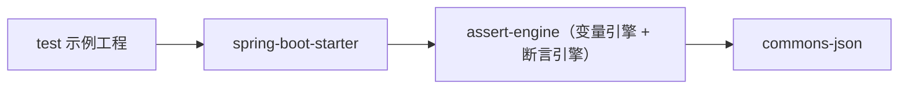

<!-- Generated by doc-sync-agent.py; sources: loadup-testify/README.md, loadup-testify/ARCHITECTURE.md -->

Testify 是 JUnit Jupiter / Spring Boot Test 的测试辅助工具，提供案例文件加载、变量展开、数据准备，以及响应、异常和数据库断言。测试顺序与业务调用由普通 Java 测试控制；Testify 不负责工作流编排、HTTP 请求、Mock、建表或生产运行时功能。

## 接入

在 `dependencyManagement` 导入 [Testify BOM](loadup-testify-bom/)，再以 `test` scope 添加 starter。JUnit 与 Spring Boot Test 由消费工程的 BOM 管理，需显式添加；真实数据库测试还需消费工程提供 JDBC driver、schema 初始化和可选 Testcontainers。

```xml
<dependencyManagement>
    <dependencies>
        <dependency>
            <groupId>io.github.loadup-cloud</groupId>
            <artifactId>loadup-testify-bom</artifactId>
            <version>0.0.1-SNAPSHOT</version>
            <type>pom</type>
            <scope>import</scope>
        </dependency>
    </dependencies>
</dependencyManagement>
<dependencies>
    <dependency>
        <groupId>org.springframework.boot</groupId>
        <artifactId>spring-boot-starter-test</artifactId>
        <scope>test</scope>
    </dependency>
    <dependency>
        <groupId>io.github.loadup-cloud</groupId>
        <artifactId>loadup-testify-spring-boot-starter</artifactId>
        <scope>test</scope>
    </dependency>
</dependencies>
```

## 最小断言

通过构造器注入 `ScenarioAssert`，将实际结果与字段期望比较：

```java
private final ScenarioAssert assertions;

@Autowired
MyServiceTest(ScenarioAssert assertions) {
    this.assertions = assertions;
}

@Test
void verifiesResultFields() {
    assertions.verify(
            Map.of("status", "CREATED", "amount", 1200),
            Map.of("status", "CREATED", "amount", Map.of("op", "ge", "val", 1000)));
}
```

## 使用边界

- 无数据库时可使用响应、异常和变量断言；starter 的 JDBC 依赖仍可能触发数据源自动配置，按 Spring Boot 版本排除相应 `DataSourceAutoConfiguration`。
- `TestScenario.clean` 是物理删除，只能用于独占测试数据；使用唯一业务 ID 和限定范围清理。JDBC 不触发应用 ORM 的审计、租户或逻辑删除监听器。
- 异步断言需要可见的已提交数据。测试事务未提交时，后台消费者通常无法读取；共享容器并行测试不要整表清理。
- 案例文件应来自可信测试资源；SpEL 变量表达式不是不可信输入的沙箱。解析变量、绑定业务输入和调用服务都由测试显式执行。
- `TestScenario.assertDb` 与 `ScenarioAssert.verifyDb` 是不同 API，默认等待策略和失败语义不同。

## 文档导航

- [Starter 接入与自动配置](loadup-testify-spring-boot-starter/)：Bean 条件、案例加载、JDBC API 和扩展入口。
- [断言引擎接入与语义](loadup-testify-core/)：变量函数、操作符、数据库匹配、异常比较和失败报告。
- [总体架构](./#architecture)：模块职责、依赖方向、生命周期与隔离不变量。
- [可执行示例](loadup-testify-test/)：测试资源、示例场景和运行方式。

---

<a id="architecture"></a>
## 设计与实现

### 定位与职责边界

Testify 是测试依赖，减少测试中的数据准备和断言重复。JUnit 控制测试生命周期，Spring Boot 创建测试上下文，Testcontainers
提供真实环境；Testify 接收测试明确交付的数据和实际结果。不引入 YAML 工作流、方法反射调用、全局 AOP Mock 或生产运行时。

### 模块依赖



箭头表示依赖，聚合 POM 本身没有执行逻辑。assert-engine 负责变量解析、响应/数据库/异常比较和 diff；starter 提供 Spring
装配、案例加载及便捷 JDBC API。变量解析复用 loadup-commons-json 的 JsonUtil。Testcontainers 是独立组件，不是 Testify 内置后端。

### 调用路径

```text
JUnit @MethodSource → CaseFiles → TestifyCase
                                ↓
                   VariableEngine.resolveVariables
                                ↓
                   resolveValue(input) → 类型绑定
                                ↓
                   测试代码调用 Service/Facade/HTTP
                                ↓
                   ScenarioAssert → Response/DB/Exception Engine
                                ↓
                   OperatorProcessor → Matcher → DiffReportBuilder
```

数据库准备走另一条显式路径：TestScenario.clean/insert → JdbcTemplate。异步断言是 TestScenario.assertDb → DbAssert，或
verifyDb → DbAssertEngine。两种 API 不共享默认等待策略。

### 自动配置与生命周期

TestifyAutoConfiguration 在 DataSource/JdbcTemplate 自动配置之后执行，要求 JdbcTemplate 类可加载。各 Bean 使用
ConditionalOnMissingBean，消费测试可替换：

| Bean                  | 前置条件                          | 责任                                     |
|-----------------------|-----------------------------------|------------------------------------------|
| VariableEngine        | 无额外 Bean 条件                  | 默认只注册 TimeFunction / CommonFunction |
| ResponseAssertEngine  | VariableEngine                    | 响应字段与 JsonPath                      |
| ExceptionAssertEngine | VariableEngine                    | 根因类型与消息                           |
| TestScenario          | JdbcTemplate Bean                 | JDBC 准备/清理与轮询入口                 |
| DbAssertEngine        | JdbcTemplate Bean、VariableEngine | 多行数据库断言                           |
| ScenarioAssert        | 两个非 DB 引擎，DB 引擎可选       | 对外断言门面                             |

TestScenario/引擎是 Spring Bean；DbAssert 是每次 assertDb 创建的可变链式对象，不应跨测试共享。用例变量 context
由测试每次生成，不存在自动的测试级变量生命周期管理。自定义函数注册表在构造 VariableEngine 时确定，默认配置不收集函数 Bean。

### 数据、事务与隔离

JDBC 插入与物理删除不会执行 MyBatis-Flex 的审计、ID、租户和逻辑删除监听器。测试负责表结构、完整必填字段、唯一
ID、租户范围和清理。同步测试可利用事务回滚；异步消费者需要已提交的测试数据，不能默认依赖测试线程的事务。

容器复用只复用数据库实例，不等于样本隔离。整表删除与 schema.sql 重建不适合共享数据库上的并行测试。业务
ScopedValue/安全身份/追踪上下文由被测试应用按自身规则传播，Testify 不自动设置。

### 断言与失败语义

响应比较是期望字段驱动，不是默认整对象严格一致。根层 JsonPath 和字段操作符通过递归检查；失败收集 FieldDiff，再输出带路径的
AssertionError。数据库差异增加行索引和缺失行信息。异常比较先取最深 cause，与外层业务 ResultCode 断言职责不同。

未知操作符回退 eq；变量解析失败常保留占位符而不是立即抛错。这些宽松路径可能造成配置错误不明显，测试应校验变量及明确操作符。对象
Map 的空值和集合空值处理存在差异，不能把解析过程当作原样保留的 JSON transformation。

### 已实现能力与局限

| 已实现                        | 当前限制                                                                   |
|-------------------------------|----------------------------------------------------------------------------|
| 文件批量输入                  | 无自动业务调用、请求发送和流程编排                                         |
| 对象/JSON/数据库/异常比较     | 无统一全局超时、默认上下文提取或事务管理                                   |
| 自定义表达式函数              | 需要显式替换 VariableEngine 注册，不自动发现 Bean                          |
| 轮询数据库状态                | DbAssert 与 DbAssertEngine 策略不同，SQL 错误重试行为也不同                |
| 多行 strict / _match / _count | 读取范围由匹配条件决定；无条件回退 LIMIT 100，没有稳定排序或全表完整性保证 |
| 测试 JSON 绑定                | 静态/私有 Mapper，不复用 Boot 的全局 Jackson 设置                          |

这些限制应作为接入契约，不能在文档中写成已完成的能力。增加新的传输、Mock 或环境能力前，优先组合成熟测试工具。

### 扩展与验证

替换 VariableEngine 可增加函数；替换引擎 Bean 可修改断言策略。OperatorMatcher 是 Java 接口，但 OperatorProcessor
当前使用固定静态列表，不是 Spring SPI；仅声明自定义 matcher Bean 不生效。

已有验证源码包括
ScenarioAssertTest、TestifyAutoConfigurationTest、UserServiceIT、UserServiceBatchIT。职责和执行命令见 [测试模块](loadup-testify-test/)
。待验收：当前版本的 Maven 与真实数据库测试。接入手册见 [README.md](./)。

### BOM 与父 POM

`loadup-testify-bom` 是独立 POM 制品，管理 core 和 starter 的版本，不包含执行示例模块，也不导入 framework BOM。
仓库根父 POM 分别导入 Testify BOM 与 loadup-framework-bom，负责为自身子模块提供版本。
普通消费方导入 Testify BOM 即可取得两个测试工具坐标的版本，不必继承本仓库父 POM。
